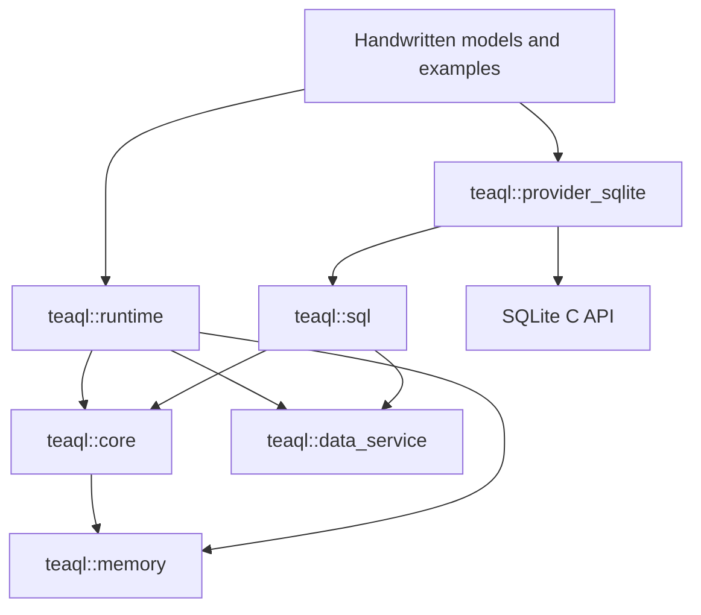

# Rust 5.0.5 core design parity contract

Preserve the pinned Rust version's core concepts, responsibilities, field semantics, execution order, and error behavior. Adapt ownership, allocation, and resource lifetimes for C++. SQLite-only scope does not justify deleting interfaces or merging layers. This contract replaces the initial direction that combined layers and reduced the core model.

The [Context API design and memory-safety review](context-design-review.md)
records the original API adaptations and ownership-safety gaps. The
[memory implementation](context-memory-implementation.md) adds selected ownership
mechanisms; Context capabilities propagate through the accepted runtime and
SQL executor/transport contracts. Neither
changes the pinned Rust baseline or reduces layer responsibilities.

The [Context memory and string storage design](context-memory-design.md) extends
that direction with object IDs, validity bitmaps, allocation limits, and string
storage. These C++ ownership adaptations must preserve the core concepts and
Value semantics below; design references are not new runtime dependencies.

Baseline: `62940ae2b88e7acc32763853b8b4685a01c7e90a` in `upstream.lock.json`. The [source concept inventory](parity/upstream-concepts.md) and `parity/upstream-inventory.json` index declarations, committed source hashes, and test locations. They identify omissions; they do not prove structural or behavioral completion. The [module map](parity/cpp-module-map.md), generated from manually maintained `parity/cpp-modules.json`, records targets, stages, differences, and acceptance contracts. Its verifier assigns each of the 82 pinned source files to exactly one contract.

All six in-scope stages are accepted at the final 2026-10-10 source snapshot.
Native and ASan/UBSan pass 388/388; matched-engine MIPS/QEMU passes 387/387.
The module ledger has 55 accepted groups and no partial groups. Detailed
implementation notes below retain their sequential checkpoint evidence; older
pending-work language describes that checkpoint rather than the current verdict.
See the final migration plan and requirement audit for current acceptance,
external exclusions, disabled final leak scanning and physical-device deferral.

## 1. Concept boundaries

| Rust layer / concepts | C++ responsibility | Current status and required work |
| --- | --- | --- |
| Value / DataType / Decimal / Timestamp | Lossless values, objects/lists, typed NULL, conversions/serialization | Accepted in its implementing source contract, including complete APIs/defaults/protocols and explicit Context ownership. See the module map and API audit; final Stage 6 composition is accepted on native, sanitizer and MIPS/QEMU. |
| PropertyDescriptor / RelationDescriptor / EntityDescriptor | Constraints, relation keys/cardinality/attach/delete_missing, service and audit metadata | Accepted in its implementing source contract, including complete APIs/defaults/protocols and explicit Context ownership. See the module map and API audit; final Stage 6 composition is accepted on native, sanitizer and MIPS/QEMU. |
| Expr / BinaryOp / ExprFunction | Full expression trees, functions/subqueries/logic/list values | Accepted in its implementing source contract, including complete APIs/defaults/protocols and explicit Context ownership. See the module map and API audit; final Stage 6 composition is accepted on native, sanitizer and MIPS/QEMU. |
| SafeExpression / TeaqlEmpty | Root-owned optional evaluation, apply/short-circuit/lazy fallback/callback/entity/list access | Accepted in its implementing source contract, including complete APIs/defaults/protocols and explicit Context ownership. See the module map and API audit; final Stage 6 composition is accepted on native, sanitizer and MIPS/QEMU. |
| core::eval::LoadState / EvalResult<T> | Five distinct load states, present/null/missing evaluation, missing-path composition, Clone/Debug/serde | Accepted in its implementing source contract, including complete APIs/defaults/protocols and explicit Context ownership. See the module map and API audit; final Stage 6 composition is accepted on native, sanitizer and MIPS/QEMU. |
| query::* | NamedExpr, OrderBy, Aggregate, RelationLoad/RelationAggregate, ObjectGroupBy, raw projections, pagination/streaming | Accepted in its implementing source contract, including complete APIs/defaults/protocols and explicit Context ownership. See the module map and API audit; final Stage 6 composition is accepted on native, sanitizer and MIPS/QEMU. |
| request::* / dynamic_search::* | QuerySelection and builder/runtime conversion, relation selection/filtering, facets/search | Accepted in its implementing source contract, including complete APIs/defaults/protocols and explicit Context ownership. See the module map and API audit; final Stage 6 composition is accepted on native, sanitizer and MIPS/QEMU. |
| Record / CompactRow / SmartList | Named records, compact rows, totals/aggregates/summary/facets/loaded state | Accepted in its implementing source contract, including complete APIs/defaults/protocols and explicit Context ownership. See the module map and API audit; final Stage 6 composition is accepted on native, sanitizer and MIPS/QEMU. |
| TeaqlEntity / Entity / BaseEntity / IdentifiableEntity / VersionedEntity / Audited | Domain contracts, decoding/write values, loaded/dirty boundaries, reason-bearing save gates | Accepted in its implementing source contract, including complete APIs/defaults/protocols and explicit Context ownership. See the module map and API audit; final Stage 6 composition is accepted on native, sanitizer and MIPS/QEMU. |
| MutationValues / EntitySnapshot / GeneratedValues | Write intent, persisted state, provider output | Accepted in its implementing source contract, including complete APIs/defaults/protocols and explicit Context ownership. See the module map and API audit; final Stage 6 composition is accepted on native, sanitizer and MIPS/QEMU. |
| Insert/Update/Delete/Recover/Batch*Command | Exact command shapes, traces, versions, old_values | Accepted in its implementing source contract, including complete APIs/defaults/protocols and explicit Context ownership. See the module map and API audit; final Stage 6 composition is accepted on native, sanitizer and MIPS/QEMU. |
| core::EntityGraph* | Annotated save input and relation edges | Accepted in its implementing source contract, including complete APIs/defaults/protocols and explicit Context ownership. See the module map and API audit; final Stage 6 composition is accepted on native, sanitizer and MIPS/QEMU. |
| TraceKind / TraceNode | Hierarchical operation/request/relation/entity/provider/SQL/comment/purpose/audit trace | Accepted in its implementing source contract, including complete APIs/defaults/protocols and explicit Context ownership. See the module map and API audit; final Stage 6 composition is accepted on native, sanitizer and MIPS/QEMU. |
| core::BusinessId* | Definitions/requests/scopes/plans/allocations/values/errors and separate Allocator/Profile/Slot | Accepted in its implementing source contract, including complete APIs/defaults/protocols and explicit Context ownership. See the module map and API audit; final Stage 6 composition is accepted on native, sanitizer and MIPS/QEMU. |
| data-service::* | Provider-independent requests/results/capabilities/observers and query/mutation/guard/transaction/schema/ID interfaces | Accepted in its implementing source contract, including complete APIs/defaults/protocols and explicit Context ownership. See the module map and API audit; final Stage 6 composition is accepted on native, sanitizer and MIPS/QEMU. |
| SqlDialect / CompiledQuery / SqlBindings | Compilation, parameter provenance, schema SQL, dialect extension | Accepted in its implementing source contract, including complete APIs/defaults/protocols and explicit Context ownership. See the module map and API audit; final Stage 6 composition is accepted on native, sanitizer and MIPS/QEMU. |
| SqlTransport / StreamingSqlTransport / SqlTransactionTransport / SqlTransaction | SQL I/O, cursors, transaction resources | Accepted in its implementing source contract, including complete APIs/defaults/protocols and explicit Context ownership. See the module map and API audit; final Stage 6 composition is accepted on native, sanitizer and MIPS/QEMU. |
| SqlDataServiceExecutor / SqlDataServiceTransaction | Adapt requests through dialect/transport; metadata, rereads, diagnostics | Accepted in its implementing source contract, including complete APIs/defaults/protocols and explicit Context ownership. See the module map and API audit; final Stage 6 composition is accepted on native, sanitizer and MIPS/QEMU. |
| SQLite provider | SqliteDialect/MutationExecutor/SchemaProvider, ID/business-ID allocators, registration | Accepted in its implementing source contract, including complete APIs/defaults/protocols and explicit Context ownership. See the module map and API audit; final Stage 6 composition is accepted on native, sanitizer and MIPS/QEMU. |
| RuntimeModule / registry / UserContext | Metadata/entities/behavior/checkers/decoders/executors/resources | Accepted in its implementing source contract, including complete APIs/defaults/protocols and explicit Context ownership. See the module map and API audit; final Stage 6 composition is accepted on native, sanitizer and MIPS/QEMU. |
| EntityDataService / RuntimeDataService / ContextDataService | Entity queries/saves, Context binding, relations and policy | Accepted in its implementing source contract, including complete APIs/defaults/protocols and explicit Context ownership. See the module map and API audit; final Stage 6 composition is accepted on native, sanitizer and MIPS/QEMU. |
| EntityKey / EntityGraphBuilder / LoadedRelation / RelationHandle / EntityRuntimeState | Identity consistency, relation state, snapshots, changes and ledger | Accepted in its implementing source contract, including complete APIs/defaults/protocols and explicit Context ownership. See the module map and API audit; final Stage 6 composition is accepted on native, sanitizer and MIPS/QEMU. |
| EntityStatus / EntityAction | Full transition table and invalid-transition errors | Accepted in its implementing source contract, including complete APIs/defaults/protocols and explicit Context ownership. See the module map and API audit; final Stage 6 composition is accepted on native, sanitizer and MIPS/QEMU. |
| GraphNode / GraphMutationPlan / GraphMutationBatch / TraceScopeToken | Input normalization, planning/batches/trace scopes | Accepted in its implementing source contract, including complete APIs/defaults/protocols and explicit Context ownership. See the module map and API audit; final Stage 6 composition is accepted on native, sanitizer and MIPS/QEMU. |
| Checker / TypedChecker / CheckResult / ObjectLocation | Validation, field locations, loaded/dirty boundaries, translation | Accepted in its implementing source contract, including complete APIs/defaults/protocols and explicit Context ownership. See the module map and API audit; final Stage 6 composition is accepted on native, sanitizer and MIPS/QEMU. |
| MutationPolicy / Registry / ApprovalProvider / Governance* | Plan review, version-fingerprint approval, governance events | Accepted in its implementing source contract, including complete APIs/defaults/protocols and explicit Context ownership. See the module map and API audit; final Stage 6 composition is accepted on native, sanitizer and MIPS/QEMU. |
| TransactionScope / GraphTransactionBoundary | Context transaction and graph-save atomic boundaries | Accepted in its implementing source contract, including complete APIs/defaults/protocols and explicit Context ownership. See the module map and API audit; final Stage 6 composition is accepted on native, sanitizer and MIPS/QEMU. |
| RawAuditEvent / SafeAuditEvent / sinks | Separate raw events/output projections and field/snapshot semantics | Accepted in its implementing source contract, including complete APIs/defaults/protocols and explicit Context ownership. See the module map and API audit; final Stage 6 composition is accepted on native, sanitizer and MIPS/QEMU. |
| SqlLogContext / SqlIntentRedactions / logging / formatter | Provenance/reprojection/intent privacy/outcomes/unified formatting | Accepted in its implementing source contract, including complete APIs/defaults/protocols and explicit Context ownership. See the module map and API audit; final Stage 6 composition is accepted on native, sanitizer and MIPS/QEMU. |
| SchemaProvider / SchemaExecutor / SchemaInvocation / bootstrap | Metadata services, persistent schema, Context-managed invocation | Accepted in its implementing source contract, including complete APIs/defaults/protocols and explicit Context ownership. See the module map and API audit; final Stage 6 composition is accepted on native, sanitizer and MIPS/QEMU. |
| ID/business-ID services | Allocation/scopes/clocks/sequences/encoding/schema | Accepted in its implementing source contract, including complete APIs/defaults/protocols and explicit Context ownership. See the module map and API audit; final Stage 6 composition is accepted on native, sanitizer and MIPS/QEMU. |
| EntityReference / round-trip reference | Claims/encoding/trusted principals/document scope/authorization/decoding | Accepted in its implementing source contract, including complete APIs/defaults/protocols and explicit Context ownership. See the module map and API audit; final Stage 6 composition is accepted on native, sanitizer and MIPS/QEMU. |
| telemetry / i18n / pagination / aggregation-cache interfaces | Observation/language/cursor/ID-set/cache abstractions | Accepted in its implementing source contract, including complete APIs/defaults/protocols and explicit Context ownership. See the module map and API audit; final Stage 6 composition is accepted on native, sanitizer and MIPS/QEMU. |
| core::web / core::xls | Defined data models and conversions | Accepted in its implementing source contract, including complete APIs/defaults/protocols and explicit Context ownership. See the module map and API audit; final Stage 6 composition is accepted on native, sanitizer and MIPS/QEMU. |
Retain auxiliary types/errors/internal diagnostics/test oracles under their module, or provide source-supported C++ equivalents. Type scans do not fully cover external reexports such as Decimal, public functions/constants, trait defaults, or serialization; audit them with their sources.

## 2. Dependencies

The composition root registers concrete SQLite services with runtime. Providers depend on runtime when implementing runtime interfaces; CMake propagates required error-model linkage. Runtime now links only the independent SQL layer and has no SQLite C API symbols. The earlier combined SqliteSession/compiler is retained in an explicit, opt-in compatibility target; neither runtime nor provider depends on it. See the [compatibility boundary](sqlite-compatibility.md) and its compiled-artifact/dependency check.

SqliteSession remains an extra C++ compatibility API and must not replace production compilation, provider I/O, runtime policy or source log projection. The examples use their separate source-aligned layers. Public layers obtain allocation-domain facilities from memory rather than including runtime/context.hpp. Data-service interfaces use provider-independent types and return ExecutionMetadata. Namespaces distinguish identically named concepts from different Rust crates.

## 3. Execution order

Queries: domain Request/PurposedQuery → QuerySelection conversion → EntityDataService → request policy/load planning/executor resolution → QueryRequest → SqlDataServiceExecutor → SqlDialect/SqlBindings → SqlTransport → SQLite → CompactRow/ExecutionMetadata → entity decoding/identity graph/relation loading → SmartList. Streams preserve independent cursor/chunk/cancellation boundaries.

Save entry points have different ordering and must not be collapsed:

- `GraphSaverFor::save_graph_dyn`: `plan_graph` → `graph_policy_plan` → `review_mutation_plan` → transaction begin → `execute_graph_plan_internal` → commit; execution failure rolls back. Rejected plans do not begin transactions.
- `save_ledger_dyn`: detect cancelled new roots → `ledger_policy_plan` → review → begin → `execute_ledger_plan_internal` → reread the current root with the **transaction executor** → commit → `root.clear_committed()`. Reread failure must remain rollback-capable; do not reread with an ambient executor after commit.
- `TransactionScope::save_audited` retains flushed ledgers until outer execution commits successfully. Rollback preserves retry intent. Scope queries/mutations use its actual transaction, not a boolean transaction flag.
- Checker/behavior/required-field gates belong at the corresponding prepare/plan/execute points. Ledger required-field checks precede Deletes/Inserts/Updates.
- Mutations in resolved.rs emit events through UserContext: raw sink → safe projection/sink → formatter. Version 5.0.5 does not uniformly defer this until commit, and rollback does not retract events already delivered to external sinks.

These orders come from entity_save.rs, context/transaction.rs, data_service/graph.rs, resolved.rs, and context.rs::send_event_inner. Differential tests must cover policy rejection, reread/sink/commit failures, and ledger retention, not only final rows.

Logs: compiler provenance → statement execution metadata from provider/executor → runtime safe projection → SQL/unified entry → formatter/sink. Execution input, raw events, and output projections remain independent. Observers report failures/cancellations that cannot return ordinary results. Validate composition against each Rust method; diagrams are not acceptance proof.

## 4. C++ adaptations

- Map traits to concepts or separate interfaces while retaining responsibilities, operations, and errors.
- Explicit Global/User scopes own business objects formerly represented by owned values/Box/Arc. Borrows do not extend Context lifetime; retain identity, relations, and snapshots.
- Use PMR, nested allocator propagation, and explicit destination-domain deep copies without hidden default-heap fallback.
- Stop native work, release resources, and destroy objects before reclaiming every arena block.
- Preserve asynchronous/stream/cancellation semantics despite synchronous SQLite operations. Immediate standard-library implementations are acceptable foundations, not proof of full asynchronous parity.
- Result may use explicit error types/exceptions, but classifications and failure behavior remain required.
- Optimize synchronization, caching, layout, and compact storage without changing observable business behavior.

### Query representation

Rust permits builder/field name collisions that C++ cannot express. These are renamings, not removed fields:

| Rust | C++ storage / operation |
| --- | --- |
| filter / having | predicate / having_predicate, with corresponding builders |
| hard_limit / search_with_text | hard_limit_value / search_text, retaining builders |
| comment / raw_sql | comment_text / raw_sql_text; absent differs from empty |
| partition_by / top_n_probe_parent_threshold | partition_field / top_n_probe_parent_threshold_value |
| group_by / order_by / raw_sql_search_criteria | group_by_fields + group_by(); order_by + add_order(); criteria field + add_raw_sql_search_criteria() |
| namespace / Expr::and / Expr::or | namespace_name / all_of / any_of to avoid C++ keywords |

Expr::kind selects active contents: Column uses name; Value literal; Function function_kind/args; Binary op/two args, with IN lists as Value::List; SubQuery op/left args/separate metadata-query storage; Between three args; unary expressions one arg; And/Or args. Equality compares the active variant.

Recursive ScopedBox storage carries an explicit resource and destroys nested objects without owning/extending Context. Global query/Expr copies recursively copy descriptors, strings, expressions, relation queries, and configuration. Cross-domain moves retain the destination allocator; same-domain moves avoid reallocation. Root destruction cleans nested objects before Context reclaims blocks.

prepare_for_list returns a complete copy. The outer query uses its own hard_limit; relation queries/child enhancements recursively use 10,000. It adds no extra ceiling to object groups/expression subqueries and is not stream preparation. Legacy execution explicitly rejects unsupported advanced fields.

### Schema execution

ensure_schema resolves provider → invokes it with private SchemaInvocation → invokes installed BusinessIdSchemaService → awaits generated bootstraps in registration order. Missing providers/failures stop later stages. Registration is passive and does not run DDL. Runtime schema providers differ from data-service metadata providers: `teaql::runtime::SchemaProvider` and `teaql::SchemaProvider` respectively.

Private invocation/orchestration have 384 comparisons. RuntimeModule descriptors/bootstrap callbacks/sinks/initial-root graphs/entities/behavior/four decoder forms are present with explicit target-domain copies; language registration now has the public-call/ownership evidence below; checker registration and Context validation have the public-call/ownership evidence below; graph-save invocation remains pending.

The physical SQLite provider reads Context metadata, starts a native transaction, installs ID-space support, creates/evolves/verifies tables/indexes, and validates FKs. schema_created/field_added/schema_verified occur after their actions and before commit; source ignores returned delivery errors. Failed COMMIT still attempts ROLLBACK. Success clears query caches, then legacy initial/root graphs produce the typed-bootstrap-required error. Moving that rejection before DDL changes observable side effects.

735 public-entry observations use real UserContext.ensure_schema, not copied DDL logic. Coverage includes sqlite_master, types/nullability/length/numeric domains, full indexes, relation directions/service boundaries/FKs, soundex, Unicode names, repeated calls, rollback-visible events, and post-commit legacy rejection. Native tests cover failed commit/cache timing/sink errors and exceptions/connection wait-close/domain copies. Unicode scalar/four final-sigma digests match Rust 1.97.1 / Unicode 17. Full entity runtime, graph save, and schema backfill remain pending.

Rust generated-bootstrap task-local scope becomes a transient GlobalContext marker plus guards around callbacks/child polls/cancellation. Restore after pending/failure/success; never retain authority across suspension or use TLS/singletons. Context close cancels the outer operation before cancelling children inside its scope. Same-Global synchronous nesting inherits mode; separate applications do not. Tests compare real audit identities/events as well as flags and physical effects.

### Audit models and projection

RawAuditEvent retains values/updated fields/old-new snapshots/changes/trace/bootstrap identity/full governance. Eight event kinds/factories stay separate; missing optional differs from Value::Null. SafeAuditEvent is a distinct type with safe fields/trace/governance and no added bootstrap. EntityKey comparison uses its construction-time cached identity; copies retain it and public ID mutation does not recompute it. Explicit allocator constructors replace Rust new/new_static and copy entity names into the chosen domain.

Count Unicode scalars; mask before truncate. Hidden underscore fields still contribute secrets. Preserve nested credentials, overlapping fields, and stable equal-length secret order. Ordinary raw-log projection copies the event and retains only ID/version business values; credentials remain hidden even under confirmed plaintext. Clear trace entity_type/comment and bootstrap actor/reason; retain category/governance as source. Do not merge raw/safe projections.

Separate raw/safe sinks borrow checked domains. The in-memory raw sink invokes registration order and stops at first failure. Copying collections never extends User sink lifetime. 1,427 observations compile original event/privacy sources; null-default-PMR/close tests cover nested copies. Event delivery/LogManager are documented below; governance/business save integration remains pending.

### SQL log models and reprojection

SqlLogEntry preserves independent context/operation/optional comment-purpose-audit reason/trace path/parameterized SQL/parameter slots/debug-pretty SQL/start-end time/duration/result count-kind/summary. Info and SQL payloads remain separate; unified entries/buffers retain time/user/trace. Options default enabled with separate Select/mutation switches. Legacy examples use separate simplified log types.

Projection consumes compiler-owned policies/generated_sql/intent, preserves slots/count facts, and never exposes Unknown or nested credentials through plaintext requests. Render failure clears every parameter value and intent. Already-safe entries cannot be upgraded. Debug entries hold a private safe copy without original bindings and a SHA256 fingerprint; reprojection validates fields. Tampering/missing state triggers source fallback, hiding intent/trace. Safe copies have no projection state, preventing recursive ownership; domain copies preserve this structure.

425 observations cover full Debug text/reprojection. Native tests disable default PMR and inspect Global copies after User close. SHA256 shares the fixed-storage Business ID implementation without dependencies. Duration retains u64 seconds/nanoseconds and checks carry overflow; timestamps still use ExecutionMetadata's system_clock range, whose equivalence to wider Rust SystemTime requires audit. SQLite is the supported rendering dialect. Context buffering/event delivery exist; business call sites remain pending.

### Formatters, factories, and configuration

LogFormatter has SQL, ordinary-audit, and sensitive-audit entries. The default sensitive method delegates to ordinary audit, so third-party formatters need not expose payloads. Ordinary Human/Debug audit output includes field names/entity IDs; sensitive entries output values/full RawAuditEvent Debug including bootstrap/governance/cached identity. Formatting does not perform privacy projection; LogManager projects first.

Human uses UTC milliseconds, rounded microsecond duration, trace/intent, and missing-projection hints. Debug preserves caller trace separately from entry trace. Sensitive output truncates bytes at UTF-8 boundaries; SQL gains a non-executable marker. 927 comparisons normalize only volatile current-time prefixes, while native tests verify UTC shape/time intervals.

The lazy Global factory reads TEAQL_LOG_FORMAT on first use: json/debug selects DebugReaderFormatter, otherwise Human. Later environment changes do not replace it. Separate applications initialize independently; allocation in User/another Global is rejected. LogConfig preserves exact level tokens, Unicode whitespace trim, ASCII case-insensitivity, and SQL substring filtering. Missing/empty environment tokens and empty vectors/vectors containing an empty string remain distinct. Configuration copies explicitly across domains; outputs use caller-selected arenas.

### LogManager output and application state

GlobalContext explicitly owns LogManager. Configuration, ordinary endpoints, and separate SQL/audit sensitive endpoints initialize lazily, including absent sensitive endpoints. Preserve switch/filter/projection/formatting order. Ordinary files append headers/body; sensitive files append projected bodies truncated to 64 KiB. Source ignores file open/write failures. Headers are attempted once, even when directories appear later. stdout/stderr failures become exceptions; failed first header/plaintext-warning initialization remains poisoned.

Read plaintext permission on each call. Direct audit projection and Manager share one warning state within a Global; different applications initialize independently. Missing/credential fields short-circuit before warnings. This explicit application lifetime replaces source process-static ownership.

94 isolated-process comparisons inspect real files/stdout/stderr, normalizing Human time, executable names, and the inaccurate source JSON header hint: source json chooses Debug, which the C++ header explicitly states. Linux uses /proc/self/exe for default filenames; other platforms currently fall back to teaql.log and need native-path adaptation. Context buffering/event delivery exist; governance/business call sites remain pending.

### Context metadata recording and buffering

Metadata containing statements records child statements recursively without another parent entry. Recover/Batch/Schema map to Update. Disabled options return before projection. Extract the final comment/purpose/audit reason, preserve both normalized-trace branches, and prefer result_count including zero. Negative elapsed intervals become zero; differences across the full signed-nanosecond system_clock range avoid subtraction overflow.

Save safe logs/unified buffer before ordinary output, then sensitive output. Records remain readable after stdout failure. sql_logs returns an independent Context snapshot. clear_sql_logs/disable_sql_log do not change UnifiedLogBuffer; disabling options does not clear existing records. User writes into a registered Global buffer explicitly copy into its domain.

315 observations compile original private logging methods with a minimal fields/get_resource wrapper. Registration has separate runtime evidence; the wrapper is not a complete Context. Native tests cover routing, save-before-output-failure, cross-domain retention, and final close diagnostics.

User identity preserves Some/None/empty setters/builders. Construction captures USER, then USERNAME, then main; invalid UTF-8 behaves as missing. The diagnostic form remains user@pid-N.tid-N. Linux uses native TID and other platforms hash C++ thread IDs rather than reproducing Rust private ThreadId numbering. Strings belong to User.

Event delivery preserves governance/bootstrap attachment, raw sink, safe sink, LogManager, and error order. Physical SQLite schema retains audit inside transactions. Full business/transaction call sites, graph saving, and governance approval require later acceptance.

### Telemetry and propagation

Attribute variants are String/Integer/Float/Boolean. RuntimeOperation retains family/name/ordered attributes and two constructor defaults. attribute rejects only the nine exact source keys; the public container is not retroactively filtered. Error classification retains ASCII normalization/substrings and timeout, authorization, validation, conflict, transport, provider priority.

Telemetry/Scope/PropagationContext/Noop/two FailOpen wrappers remain separate. Registration borrows explicit origin domains; lazy default Noop belongs to User. Start/extract failures do not block business work. Failed activation retries business polling outside activation only if it has not already run; existing poll results survive, while business exceptions propagate. Scope business exceptions preserve source mutex-poisoning state; propagation has no such state. Success/failure consumes one delegate, isolates completion exceptions, and destroys adapters immediately. Unfinished scopes can close or be cleaned with Context.

Noncopyable ContextBox can destroy payloads early while arena bytes remain until close. claim prevents two wrappers consuming one payload. Interfaces return fresh boxes in the selected Context; retaining borrowed call inputs requires explicit copies. Destructors are noexcept. Context is owner-thread-bound; reentrant finish/activation is explicitly rejected rather than blocking on a Rust mutex.

1,032 public API observations cover values/filtering/classification/completion order/adapter and business exceptions/skipped or repeated callbacks/poisoning/propagation. Native tests cover Global copies/one cleanup/domain rejection/thread wake/finish/cancel through scope/propagation operation composition. run borrows scope and same-domain child work; all work stops before payload destruction/reclamation. No exporter/pool/static owner is added. Event delivery and Context query adapters are connected; complete entity/mutation call sites remain pending. flush/shutdown retain defaults without invented automatic timing.

### Governance scope and event delivery

with_mutation_governance copies snapshots into operation Users. Each poll/cancel/nested cleanup activates its snapshot, then restores the prior value; suspension retains no active authority. Global holds only a synchronous-stack borrow, replacing task-local storage without TLS. Sibling Users share activation through synchronous calls within one application; separate applications isolate it.

send_event copies input into User and unconditionally replaces supplied governance with the active snapshot, clearing forged snapshots outside a scope. Bootstrap identity overrides only Created/Updated. The last comment remains meaningful even when empty; only absent trace selects the default reason. Present null/invalid new_values versions prevent fallback to values. Other events/non-bootstrap calls retain supplied bootstrap identity.

Call raw sink, safe projection/sink using matching metadata mask/max settings, then LogManager. First Result error stops the chain and completes telemetry as audit_error; success has empty attributes. Sink/log exceptions propagate, close scope immediately, and do not invent completion outcomes. Module sink installation copies domain-checked borrows; User sinks cannot escape to Global/siblings.

1,088 observations extract original event/task-local method bodies; the wrapper supplies fields/services while actual event/privacy/formatter/telemetry code runs. Oracle-only tokio is already locked and is not a C++ dependency. Cover all eight events, identity overrides, empty reasons, missing/null/invalid versions, governance, sink errors/exceptions, masks, and scope release. Normalize only timestamps inside the send interval. Native tests cover nesting/pending/close/domain rejection/Global copies and real sink→file-log→telemetry order. Policy/approval/graph/business save remain pending.

### Identity graphs and mutation ledgers

Builder installs by C++ type/u64 ID; relation views use normalized owner name/ID/relation and replace same-key payloads. Frozen publication returns Context borrows and is single-use; failure returns the original builder. References retain ordinary/weak graph views and clone promotion without Arc/Weak lifetime extension.

Loaded/Empty/NotLoaded remain distinct: empty collections have values, empty to-one does not. Strict mismatched handles fail; optional resolvers return empty. Inspecting these states performs no database read.

Same-domain runtime copies share the lazy ledger slot, including copies before first mutation. Loaded CompactRow is per-view snapshot and does not allocate a ledger. Reads prefer loaded data; original versions consult ledger, then entity/numeric-ID loaded fallback. Change stacks preserve top overlays/pop/cross-layer fields/delete-clears-all. clear_committed consumes intent but retains loaded rows and deferred composition errors.

Composition checks target/source states and every source original version before copying changes, so conflicts are atomic. Successful layers merge into the target current layer; sources remain independent/retryable. Void attachment records deferred conflicts. Existing target comments, including empty strings, and original snapshots win. Preserve first-version storage separately from ordered overflow to retain first-conflict order.

241 observations compile complete entity_runtime.rs with thin private-state bridges, not rewritten algorithms. Native tests cover defaults/Context close/cyclic and aliased copies/PMR/move-only payloads/copy-scope recovery on exception. Owner-thread rules do not prove cross-thread Arc/Mutex parity or ledger-save integration.

### Runtime graphs, plans, and trace

EntityValues is mutable checker/fix/planner state, separate from mutation values/snapshots/compact rows, with destination-domain conversion. GraphNode preserves operation/relations/optional comment/dirty/original fields and cannot be replaced by the core input node. Keep four graph operations/four mutation kinds; graph_mutation_kind_for_update adapts the source enum helper.

Plans retain root/items/batches/index/visited identities. push uses then increments index; Debug checks overflow, Release preserves unsigned wrap. Rebuild merges only adjacent equal entity/kind/field-list items; only Update fields affect keys, and original order/duplicates remain. grouped_counts reads batches even before rebuild. Clearing items does not reset index/batches. Context-owned unordered_set retains identity membership, not Rust randomized iteration.

TraceScopeToken is a persistent arena parent chain. Same-domain plans/items/batches borrow it; cross-domain copies recursively copy required parents. ScopedCommentNode is a separate stack cons-list owning its node and borrowing its parent. Both skip only empty comments, preserve whitespace/kind/entity/ID, and output root-to-leaf. Parent links are immutable and acyclic.

432 public observations cover defaults/optionals/nesting/value conversion/field filtering/adjacent batches/counts/rebuild/clear/trace restoration. Native tests disable default PMR and cover nested copies/source close/same-domain tokens/invalid parent domains. Initial/root registration retains full models with destination-copy replacement. Physical SQLite schema is connected; normalization/planning/checking/graph and ledger saving remain pending.

## 5. Stage acceptance gates

1. **Design:** pinned inventory, complete concept map, dependencies/flows, memory rules, differences, and acceptance table.
2. **Models:** complete fields/enums/defaults/conversions/serialization/AST/collections/entity contracts; passing cross-domain/nested/exception/destruction tests.
3. **Layers:** separate interface tests and replaceable executor/transport fixtures; SQLite schema/query/mutation/guard/transaction/stream/ID; atomic guard+mutation statement, complete metadata, and reread evidence.
4. **Query runtime:** EntityDataService performs relations/identity reuse/projection-load boundaries/order/aggregate/pagination/dynamic search. Examples must not implement those responsibilities locally.
5. **Save/log runtime:** status transitions, ledger composition, planning/batches/checking/policy/approval/rollback/rereads/raw-safe audit/privacy/failure diagnostics have differential evidence.
6. **Parity:** identical Rust/C++ fixtures compare results/identity/state/transactions/audit/log success and failure. Examples/lifetime stress/ASan/UBSan pass and no required difference remains unexplained. Performance is not correctness proof.

Names, placeholders, capability flags, complete inventories, successful examples, and isolated green tests do not establish a stage. Deliverables must point to real implementations and evidence covering the required semantics.

## 6. Scope and dependencies

Do not implement MySQL/PostgreSQL/cloud/Redis/web frameworks/external exporters/GPU SDKs in this migration. Preserve their relevant core interfaces/models. Use handwritten models with unchanged entity semantics; do not modify the generator. memory.rs is a test oracle; telemetry_opentelemetry.rs is an optional external adapter. Index both without reducing core telemetry.

The standard library does not directly replace Decimal/JSON/cryptographic libraries. Provide concrete tested implementations, not unsafe/lossy approximations. Justify purpose/necessity/cost before adding dependencies.

Serialization follows actual source implementations. Rust Value/DataType/Expr/SelectQuery/SmartList have no Serialize/Deserialize protocol; do not invent tagged Value serde. JSON projection, transparent integer Timestamp, trimmed strings, and Web/Xls fields/defaults/JSON have corresponding implementations and observations.

### Graph decoding and behavior registration

Four independent decoder maps remain: compact/batch/list/option. Compact/batch validate u64 identity after model decode; batch installs each success immediately and preserves it on later failure. List skips u64 validation and installs a loaded SmartList only after all rows succeed. Option decodes only the first row; empty input installs None. Failed relation decodes do not replace old relations. Every call creates a fresh weak root, shared within its batch/list and isolated from the external ledger; published views resolve the same graph.

Behavior/registry/RequestPolicy are separate, with five default hooks and empty relation_loads. Module metadata uses descriptor.name; decoders use ENTITY_NAME. Behavior-only registration does not create a service; descriptor replacement does not erase decoders/behavior. apply_to copies registries into destination and preserves existing request policy.

Global/User owns behavior/policy while registration borrows. Verify all copies before installation, preserving atomic failure. Clear policy only removes a borrow. Root/builder must share a Context; copy explicitly before cross-domain calls. Empty lookups do not allocate and remain readable in quiescence. 182 public observations plus native graph/domain/resource/SQLite tests cover these contracts; full check/save integration remains pending.

Query preparation first merges repository trace, then dispatches behavior by query.entity, invokes before_select, invokes policy, and adds relation local-key projection. Generated bootstrap skips behavior only, not policy. Public behavior lookup itself does not apply this bypass. Preserve all four service/metadata roles separately from SQL/provider.

### Basic entity services and relation plans

Context resolves entity registration, metadata, then the requested executor type. for_executor can bind another executor for transaction adaptation. Factories create distinct select/insert/update/delete/recover commands. Update behavior uses repository entity; query behavior uses query.entity. Both copy caller input before preparation.

Base fetch_all forwards executor diagnostics; list/entities record returned metadata before decode; enhanced entities aliases ordinary decode and does no hydration. Base trace/comment still propagate when capture is disabled; full entity entry points must restore their own switches. Context preserves trace precedence/user prefix/empty comment rules.

RelationLoadPlan keeps fields/full optional query/children. Behavior dotted paths sort/merge heads; explicit loads retain order/duplicates. Queries use actual target/local-foreign keys, add keys to nonempty projections/child plans, set slice partitioning, and append actual-ID ordering. Compact clears nested relations. Empty parent-ID construction adds no IN; execution/hydration must skip that query.

Nonnegative I64/U64 share numeric identity; text numbers do not. Equal-key unstable-sort representation is unspecified; C++ retains the first equivalent value. Flat plans preserve explicit and behavior queries independently; every descendant requires a decoder, and planning errors precede eligibility checks.

Private intent belongs to the query scope. Descendants copy snapshots; siblings do not mutate each other. Multi-statement metadata propagates normalized per-leaf policies without replacing caller metadata before safe projection. Do not attach private intent to UserContext/shared repositories/wire requests/ledgers.

256 base-method and 112 planning observations cover entries/capture/debug/execution-decode errors/observers/trace. Native tests cover hooks/policy/bootstrap/cancel/wake/temporary wrapper destruction/domains/copies/real layered SQLite. Full entity fetch/pagination/cache/insert checking/save remain pending.

### Context query observation and per-parent relation pagination

Noop creates neither operation names nor scopes. Enabled observation creates query scope, then provider scope within its activation. Each poll activates both in order, restores after return, completes provider before query, and classifies returned errors as data_service_error without sensitive attributes. Cancellation closes scopes without fabricated completion. Fail-open isolates telemetry start/activation/completion exceptions.

fetch_all resolves trace/user/comment lazily on first poll; list/entities/enhanced preserve input comments. Keep this source difference. Query snapshots and child work can outlive temporary service wrappers but results remain User borrows. 468 verbatim-method comparisons cover fields/scopes/pending/cancel/errors/Noop/repeated-skipped callbacks/adapters. Normalize only language-specific provider.kind/type-derived operation names. Native tests verify wake and stop before scope destruction.

Top-N plans retain Window/BoundedProbes. Only many relations with slices permit probes. Explicit zero disables; positive thresholds compare unique parent count; absent thresholds follow capabilities. No IDs means no capabilities/query calls. Probe-capable providers with no explicit threshold and disabled metadata receive one partitioned semantic batch query; other probes issue sequential per-parent equality queries with partition cleared. First error stops; cancellation stops active child.

Compact window/batch clears relations, but explicit probes retain source base-query relations. Preserve slice/projections/stable ID and limited relation-load attributes. Compose through entity-fetch callbacks rather than bypassing runtime to provider. 432 observations plus SQLite pagination/tie/metadata/domain-copy tests cover execution; complete public fetch/identity publication remains separate.

### Recursive hydration and graph installation

Embedded hydration attaches first, then recursively processes each record/child. Ordinary/compact identity hydration completes descendants before installing the current level through the decoder registry. Ordinary strips partition rank and marks missing forward-one with Null; compact keeps rank and installs all returned targets. Only nonnegative signed/unsigned integers share identity.

Embedded groups are rereadable; ordinary/compact reverse installs consume groups, so duplicate parent keys can later receive loaded-empty relations. Inverse uses the first metadata match by key/direction. Embedded parents remove the current relation before inverse embedding; inverse-many appends only to List and preserves other types. Ordinary flat installs inverse before checking literal parent id, preserving partial updates on error. Compact has no inverse install. Keep empty/unloaded states, decoder forms, and fresh ledgers distinct.

First error/cancellation preserves partial updates. mem::take leaves the active embedded record empty on failure/cancel; earlier successful records survive. Child repositories retain trace/private-intent domain rules. Only embedded loading adds its relation-load telemetry. 356 original-method comparisons and SQLite/thread tests cover rows/graph/ledger/query order/trace/scopes/snapshot/cancel/close. Global graph copies preserve cycles/aliases.

Full compact/public entity fetch and purpose/cache/pagination orchestration remain pending. Examples must use the runtime. Save/check/governance require their own acceptance.

### Aggregates, object groups, and child enhancement

Three kernels compose independently through entity-fetch callbacks. Parent keys preserve duplicates/input order. Relation aggregates validate complete plans, including relations later cleared, before empty-ID defaults. Queries select actual targets, clear ordinary/expression projection/order/slice/relations, retain raw/other fields, and add count if absent. Single counts use outer alias; list counts use count. Child TTL propagates only without explicit child cache settings and with parent propagate; parent enabled does not affect propagation. This is configuration behavior, not cache execution proof.

Re-fetch metadata after rows return; physical foreign columns map to logical keys only if the logical key is missing. Remove foreign keys during grouping. Single takes first row and unwraps exactly one column; zero/multiple columns remain objects. Lists retain every object. Missing groups/parent keys produce U64(0)/empty List, including keyless parents. Duplicate parents reuse groups rather than consuming them.

Object groups/child queries preserve original queries and add needed ID projection/IN. Last duplicate target wins. Groups set Null only for keyed unmatched parents; keyless parents remain unchanged. Child enhancement merges hits only, preserving unreturned fields/unmatched rows. Both use parent trace; aggregate appends target/alias trace while preserving query trace.

Execute sequentially; preserve completed enhancements on failure/cancel and do not modify the active pending step early. 266 original-method observations compare rows/full relevant query fields/trace/errors/pending/cancel, including physical/logical coexistence, mixed identities, and planning-before-empty order. SQLite count/sum/object/overwrite and native stop/all-block tests cover kernels. Public entries must compose them in full resolved.rs order.

### Cache and pagination storage boundaries

AggregationCacheBackend, ContinuousPageCursorStore, and IdSetStore are separate. Aggregation access is synchronous: age zero is unlimited, other age uses monotonic time, and expired reads retain entries. Namespace invalidation matches namespace::. name_space adapts a C++ keyword only.

Cursor fields retain identity/query/entity/direction/boundary/page size/offset/deadline. Keys are query_key:offset. get deletes the expired target; full-capacity put evicts one earliest deadline without proactively purging others. Invalidation matches query_key:. Default capacity is 4,096. ID sets retain ordered duplicates/deadline; oversized single writes fail before expiry purge, then count/byte checks repeatedly evict earliest. Replacement undergoes the same checks. Invalidation matches full keys; defaults are 64 entries/256 MiB ID elements. Equal-deadline HashMap survivors remain unspecified.

SystemTime uses signed 64-bit seconds plus nanoseconds for pinned Unix Rust range, rather than narrowing to a roughly ±292-year nanosecond time_point. Deadlines use wall time, separate from business-date clocks/cache monotonic age. Default stores belong to User; Global stores require explicit origin registration. Observations start DISABLED/ID_SET_DISABLED and independently update cursor/count, returning domain copies.

Memory stores return lazy operations; unpolled canceled writes have no effect. Replaceable interfaces permit native async work. Reads copy to result domains and writes to store domains; retained IDs have no Arc owner. Owner-thread access does not prove Send/Sync/poisoning equivalence. Background work only notifies owner and stops before close.

259 comparisons compile original storage/observation code with private capacity/age bridges. Native tests cover domains/default isolation/replacement/outstanding work/finish-cancel-close/full deadlines. Same-key Registry/Lock/Guard primitives reuse application mutex identity and prune zero-lease entries on the next lookup. Unlock wakes one waiter; cancellation of a notified waiter transfers wake. Slots mirror source reuse without FIFO fairness; new pollers may overtake. 144 scripts compare the original registry/actual locked mutex's identity/readiness/wakes/guard/cancel. Native tests disable default PMR and join work before unlocking/reclamation.

Explicit Global ownership replaces process-static Weak/Arc directories. Separate applications isolate directories. User leases/guards/waits do not own directory memory or escape to longer domains. Reset requires prior cancellation/guard release; Context close handles dependency-order cleanup. These primitives still need miss→lock→recheck→build integration. Canonical key helpers now have separate evidence below. Public row-query cache admission/hits and continuous-page seek are connected with real SQLite evidence. ID-set miss/lock/recheck/build orchestration and write-triggered invalidation remain pending; stores/locks alone are not complete entity-query acceptance.

## Canonical aggregation and pagination query keys

The pinned aggregation key copies and recursively canonicalizes filter/having,
expression projections, expression order, relation child queries, object groups,
child enhancements, and subqueries. AND/OR flatten only the same operator, sort
stably by Rust Debug, and deduplicate adjacent structurally equal expressions.
IN/NOT IN and their large-set forms sort/deduplicate literal lists by Value Debug.
NaN remains unequal to itself; equal signed zeros keep the first sorted
representation. Empty and singleton AND/OR retain their variant. Canonical queries
remove aggregation cache, comments, trace, stream configuration, and continuous-page
configuration, while retaining result-affecting fields and ID-set configuration.

Continuous-page keys remove comment/trace and zero only slice offset. ID-set keys
remove the whole slice, projection/expression projection, relations, child
and object enhancements, comments/trace, and both pagination options. They retain
other fields, including stream and aggregation-cache options. Neither path sorts
predicates. Both hash namespace, exact normalized query Debug, and optional user
identity; ID-set additionally hashes active root entity and ID when supplied.

451 observations compile the original helper/key methods without rewriting the
algorithms. They compare complete Debug/canonical text and all three keys, covering
nested metadata/query fields, every expression/function/aggregate, Value kinds,
duplicates, NaN, signed zero, Unicode/NUL, hash block boundaries, None/empty identity,
and root variants. Pagination hashing matches DefaultHasher's SipHash-1-3 and Hash
framing on the pinned 64-bit little-endian Rust test toolchain; this is a local
compatibility key, not a portable serialized protocol or cryptographic API.

Inputs are unchanged. Temporary queries, sort keys/indexes, and outputs allocate
in explicit destination Memory; native tests disable default PMR and read retained
Global queries/keys after User close. Internal Debug contains query values and is
not a public log projection. The helpers do not yet integrate entity-level
cache hit/miss/invalidation, active Context roots, or complete pagination execution.

## Public purposed entity-query execution

`PurposedSelectQuery` snapshots the query into an explicit allocation domain,
rejects Unicode-whitespace-only purposes, and retains original purpose text in
trace provenance. `EntityDataService` now exposes row, owned-row, relation-aggregate,
basic SmartList, and basic typed-entity entries. Request preparation and policy
run before the independent executor; basic typed decoding remains separate from
enhanced identity-graph decoding.

Rows execute through aggregation-cache lookup/admission, continuous-page cursor
validation/seek/registration, and existing recursive object-group, child-query,
and requested-relation helpers. Outer relation aggregates run after cursor
registration, as in the pinned source. Cache hits avoid provider I/O and SQL
success logs, while preserving private intent reconstruction where applicable.
Provider and cache telemetry complete after their activation callbacks return.

There are 165 observations through the original public Rust EntityDataService,
without reproducing its orchestration algorithm in the oracle. Native SQLite
checks embedded relation rows, changing-purpose cursor reuse, cached counts, and
explicit cache clearing. Lifetime tests exercise lazy snapshots, Global cache
copies after User close, wake forwarding, provider cancellation, close-time
quiescence, and early-destroyed providers under a null default PMR resource.

This evidence does not establish enhanced graph entities, ID-set coordination,
mutation-triggered cache invalidation, complete privacy/governance,
checker/language module installation, or graph save.

Validation at this query checkpoint: native CTest 116/116; ASan/UBSan with leak
detection 7/7 selected lifetime/query contracts; big-endian OpenWrt MIPS
entity-service contracts and 165/165 original public-query observations through
QEMU. Formatting and locked-source verification passed. Router execution and
the remaining stage acceptance gates are still pending.

## Public root-stream execution

`EntityDataService::fetch_stream` is available when the independent executor
implements StreamQueryExecutor. Preparation/policy and prepare_for_list run
before provider cursor creation. Relation, child, and object-group enhancements
are rejected with the original error; aggregate/grouped root queries remain
allowed. Chunk size (including explicit zero), request flags, comments, and
query/envelope trace ownership follow the locked source. This path does not
prefetch rows, consult the aggregation cache, or apply continuous-page seek.

The startup operation returns a checked `EntityQueryStream<Error>` borrow.
Its stream maps each provider item to a Context-owned chunk or executor error,
forwards Pending/wake notifications, and preserves items after an error or an
early is_last marker. EOF, explicit cancellation, and User close clean up the
native cursor. If mapped-stream allocation fails after cursor creation, startup
cancels the cursor before propagating the allocation failure. Foreign-domain
cursors are cancelled and rejected. Global copies of the handle are rejected;
an inline handle can reject access after User destruction while Global remains.

This follows the existing C++ arena contract: emitted chunks remain borrowed
until User close, and previous chunks are not invalidated by polling. The
runtime does not first collect all provider rows, but retained emitted chunks
consume the User byte budget. Constant-memory streaming is not claimed. Callers
can explicitly cancel a borrowed stream; dropping a handle alone does not close
its Context-owned stream or prolong its lifetime.

The oracle calls the original public Rust fetch_stream, with only a recording
executor/native Stream fixture. Its 193 observations cover capture/observed SPI,
root and rejected shapes, chunk sizes, provider errors and continued chunks,
Pending/EOF, purposes, and default/custom hard limits through u64 boundaries.
The hard-limit message is fixed in the shared Query model, not patched only in
the runtime stream adapter. Native contracts add real SQLite chunks, one final
Context diagnostic, idle-connection reuse, cancellation, failed handoff, and
expired checked handles under a null default PMR resource.

Enhanced graph/ID-set orchestration, save/governance and complete stage acceptance
remain pending. No generator or production dependency was added.

Validation for the public stream checkpoint on 2026-10-06: native full build and
CTest 118/118; ASan/UBSan with leak detection 2/2 new stream contracts/differential
tests; OpenWrt MIPS public stream contracts and 193/193 live Rust observations
through QEMU. Pinned source, generated inventory, clang-format 18.1.8 (310
handwritten C++ files), and diff checks passed. Physical router execution and
overall six-stage acceptance remain unproven.

## Active roots and private ID-set page preparation

UserContext owns a canonical ContextEntityRef, assigned once. with_active_root
rejects blank names, zero IDs, and every reassignment. Typed require_active_root
returns a checked User borrow or an allocator-aware ContextRootError containing
the expected and actual types. Generated-bootstrap installation is idempotent
only for the identical canonical type and ID; conflicting assignments return the
original schema error. This is runtime support; the generator is unchanged.

The ID-set preparation kernel uses the actual active root in its existing key
helper, plus user identity and normalized query. Eligible queries append an ID
sort key where absent, read the independent store, acquire the application-owned
same-key build lock on miss, and recheck under the guard. It builds IDs through
the independent prepared executor path with max_ids plus one (saturating),
checks every returned ID, admits the retained set, rewrites the page predicate,
and returns retained total_count. Empty/overflowing ranges, store fallback,
provider failure, and limit rejection follow the original private method.

Cancellation stops pending provider/store/lock work before releasing its guard
and logical lease. Results remain in the User domain; explicit Global stores
own deep copies. Registered cursor and ID-set store getters now validate their
scoped borrow before calling a virtual method, so early destruction is rejected.

`id_set_page_cases.json` records 233 observations. A git archive of the locked
source receives a single public bridge that calls the original private method;
no original method body or reference checkout is changed. The same binary calls
actual public root/bootstrap/type-check methods. Compare prepared queries, root-
isolated keys, provider requests, store calls, totals, observations, and errors.
Native tests add same-key pending/recheck and wake forwarding, close cancellation,
Global copies across Users, root isolation, early-destroyed stores, and actual
SQLite ID enumeration/page execution under a null default PMR resource.

The kernel now runs from the enhanced-entity public entry, with separate
public/SQLite evidence below. The private preparation test alone cannot establish
complete public pagination or entity-query acceptance. Root/state/store operations are confined to the Context
owner thread; Rust cross-thread OnceLock/Mutex equivalence is not claimed.

Validation at this ID-set/root checkpoint on 2026-10-06: native full build and
CTest 120/120; ASan/UBSan with leak detection 5/5 selected preparation/store/
reference/memory contracts; OpenWrt MIPS native contracts and 233/233 comparisons
against the original archived method through QEMU. Rust v5.0.5 lock, inventory,
clang-format 18.1.8 (315 handwritten C++ files), and diff checks passed. Physical
router execution and enhanced-entity public pagination remain pending.

## Enhanced entity public orchestration

EntityDataService exposes enhanced entities, enhanced entities with relation
aggregates, and the owned aggregate entry. Each operation snapshots inputs,
prepares behavior/policy once, ensures identity projection, establishes its
private query-intent scope, and applies ID-set preparation before selecting the
source execution path. The retained total is attached to the resulting SmartList.

Direct context-aware decoding does not freeze an empty graph. Compact flat root
queries bypass aggregation caching and retain owned request trace handling.
Requested plans and behavior plans hydrate separately into one graph before it
is frozen. Ordinary flat paths run existing root/group/child/query-relation/
continuous-page/outer-aggregate steps, then hydrate the flat plans. Embedded
fallback additionally expands behavior relations, recursively flattens supported
nested values, installs collections/options/forward identities, and freezes the
graph. Unsupported decoder targets remain embedded; null optional values and
source decoder/error ordering are retained.

`enhanced_entities_cases.json` has 154 original public-entry observations. The
recording provider cases compare full queries, preparation counts, identity and
relation views, original snapshots, retained totals, owned/borrowed entry modes,
cache/continuous/ID-set combinations, and provider/model errors. Twenty-four
cases instead execute actual Rust/C++ SQL executors and SQLite providers. Native
contracts check shared target identity, source-specific inverse installation,
empty versus unloaded collections, aggregates, Pending/wake/close cancellation,
transient input wrappers, and explicit Global graph copies after User/SQLite
reclamation. The generator and production dependencies are unchanged.

The actual SQLite comparison confirms an upstream projection caveat: relation
loads add local keys even when the original projection is empty. In a nested
ordinary flat child query this can turn the projection into only that local key,
omitting the ID/foreign key required by later hydration; both implementations
then expose empty related views. This source behavior is preserved, not described
as successful complete loading. An explicit child projection containing ID,
foreign key, and descendant local keys exercises full graph loading. Existing
compact and ordinary helper semantics (including inverse installation differences)
remain distinct. Complete query API/privacy acceptance, checker and
save/governance stages are still pending.

Validation at the enhanced public-entry checkpoint on 2026-10-06: native full
build and CTest 122/122; ASan/UBSan with leak detection 2/2 new integration/
differential contracts; OpenWrt MIPS native contracts and 154/154 original public
entry observations through QEMU, including actual SQLite cases. Transient
purpose wrappers, close cancellation and Global graph copies are included.
clang-format 18.1.8 (319 handwritten C++ files), pinned source/inventory and diff
checks passed. Physical router execution, query API/privacy audits, checker,
mutation/save/governance and final examples/stage acceptance remain
pending.

### Language, catalogs, and Context translation

Language/Locale retain all 15 variants in source order and English as the default.
Alias parsing uses Rust Unicode whitespace trimming and ASCII normalization;
canonical catalog locale keys remain strict. In particular, `tl` is accepted,
`tl-PH` is not, and Chinese extensions beyond the exact source aliases are not
accepted. Unsupported Context codes retain their original text and leave the
current language unchanged. RuntimeModule applies language only when configured.

I18nCatalog validates exact root/locale shapes and nonempty translation strings.
Message placeholders accept only location/system/input/input_len; vocabulary
strings are not template-validated. Preserve sorted validation order and JSON
last-write duplicate-key behavior. Lookup order is custom target locale, builtin
target locale, custom default locale, builtin English, then the stable key.

Location titles use ObjectLocation Display, including `$` for the empty root,
Unicode character uppercase predicates, full initial uppercase expansion and
subsequent lowercase expansion. These are character mappings, not locale-aware
or contextual string case conversion. Bracket suffixes are retained. Text
lengths count Unicode scalars, not bytes or grapheme clusters. Timestamp messages
contain integer milliseconds, JSON is compact, Decimal retains its scale, and
object/list values retain distinct placeholder text. Template replacement follows
the source's sequential location/system/input/input_len passes, including later
placeholders introduced by earlier replacements.

4,575 observations invoke original Rust public Language, I18nCatalog, translator,
UserContext and RuntimeModule APIs. They cover builtin translations, all rules
and Value variants, malformed JSON/catalog/template precedence, Unicode case
facts, fallback/customization, replacement injection, existing empty messages,
and module language overrides. Native Context tests additionally cover allocator
propagation, scoped translators, expired catalog borrows, sibling/User-to-Global
borrow rejection, owner-thread enforcement, and explicit Global catalog/error/
message copies surviving actual User destruction.

The source builtin process-static Arc becomes immutable compiled string facts
and an explicitly scoped catalog value. Custom catalogs own PMR strings/maps;
Context stores a checked User/Global borrow and never extends ownership.
Catalog installation requires a managed object reservation; sharing an allocator
with a temporary stack catalog does not establish an adequate object lifetime.
Translation writes owned characters into each CheckResult's declared allocation
domain, enabling an explicit Global result without retaining User catalog views.
The extraction tool reads builtin JSON from the locked Git commit, and the
Unicode observation tool explicitly requires Unicode 17.0.0. Neither invokes or
modifies the application/model generator or adds a production dependency.

Graph-save checker/fix invocation remains pending; deterministic graph Fix time/evidence kernels now have the evidence below. This
implements their language dependency; it does not complete query privacy, save
governance, final examples, or the six-stage acceptance audit.

Validation checkpoint on 2026-10-06: the complete native Debug build and CTest
passed 124/124 tests. The two language/catalog tests passed ASan/UBSan with leak
detection, including managed catalog admission and complete User destruction.
OpenWrt GCC 13.3.0 compiled both targets for big-endian MIPS32r2/O32; QEMU passed
the Context catalog contracts and all 4,575 observations against live original
Rust calls. Physical-router execution remains pending. Pinned upstream,
reproducible builtin/Unicode facts, module inventory, and C++ formatting checks
passed.

### Checker interfaces, sparse typed adaptation, and Context checks

CheckObjectStatus keeps explicit create/update markers, with fallback based on
missing or Value::Null IDs. An unknown marker is not an Unknown return status;
it falls back to the ID. TypedNull counts as present here, as in the source.
Checker retains its required/minimum/maximum string helpers as overridable
methods. Helpers count Unicode scalars and ignore non-text values for length
checks. Registry lookup, last-registration replacement and module installation
remain separate responsibilities.

TypedEntityChecker extracts loaded/dirty lists, accepting only Text entries and
sorting/deduplicating them. Markers are removed from the preserved sparse input
even when materialization fails. Decode without an on_loaded Context hook; apply
loaded/dirty checker views; clone/serialize before checking; invoke TypedChecker;
serialize after checking; then merge only fields whose before/after values differ.
Defaults filled by decoding do not become updates, unknown original fields are
retained, and removing a field from the after projection does not create deletion
intent. A materialization failure restores the sparse boundary and appends an
InvalidType result with the source error message.

The typed adapter's required checks exclude ID/version and apply independently
of status; a sparse update may therefore still report missing typed required
fields. Context metadata checks exclude version but include ID, require omitted
fields on creates, and reject explicit Value::Null on updates. Preserve this
source distinction. Context captures status before custom fixes, executes the
selected checker first, then checks metadata, deduplicates newly generated
Required results by exact location, fills only missing messages, and returns
RuntimeError::Check in source order. Existing duplicate custom results remain.

1,362 observations call original public Rust helpers, typed adapters, registries,
Context validation and modules. Handwritten model decode/projection and callback
bodies are shared fixtures; no runtime adaptation/orchestration algorithm is
copied into the oracle. Fixtures observe status and loaded/dirty/boundary state,
include non-string marker members and decode failures, and distinguish Value
variants through Debug output as well as wire results.

C++ resources are explicitly managed in User or Global. Registries and typed
adapters borrow live owner slots; they never extend ownership. User-only Ref
registration resolves and validates IDs without exposing GlobalContext or scanning
known slots again. Copies into another scope clone names and validate each
resource borrow. Native tests disable the default PMR resource, destroy the
source User, and verify retained Global values/errors/adapters/modules. They
also reject untracked stack checkers, User-to-Global retention, wrong User access,
expired callbacks/registries/metadata, and Context close. A synchronous Context
checker call registers stack-based quiescence protection: reentrant close fails
fast before reclaiming its active values/results, and exception unwinding removes
the protection. This does not intercept arbitrary native pointer use or manual
destruction of a resource while its method is executing.

The metadata-only required CREATE payload gate and graph Fix time/evidence
kernels now have the evidence below. Mutation governance/approval and actual
save callers remain pending. Existing SQLite CRUD is not proof of graph save, and these checker
kernels do not complete the six-stage migration.

Validation checkpoint on 2026-10-06: the complete native Debug build and CTest
passed 127/127 tests. ASan/UBSan with leak detection passed 7/7 selected checker,
registry, metadata, schema/module and i18n contracts. OpenWrt GCC 13.3.0 built the
checker tests and probe for big-endian MIPS32r2/O32; QEMU passed both ownership/
reentrant-close contracts and all 1,362 comparisons against live original Rust
calls. Physical-device execution remains pending. Pinned baseline, module
inventory and clang-format 18.1.8 checks passed.

### Graph Fix time, evidence, and metadata-only CREATE validation

FixEvidence retains entity_type/model_path/source/source_label and both Clock
and Context sources. Constructor checks use Unicode whitespace and reject blank
fields in source order. ASCII-normalized labels containing authorization, cookie
or token= are rejected; accepted strings retain their original bytes. Explicit
allocator copies clone all strings without revalidating mutated public fields.

Standalone Context fix_time samples Timestamp::now; unscoped recording is
ignored. A graph operation lazily samples one timestamp on first poll and owns
its evidence vector in User memory. Activation exists only during child poll,
finish and cancellation, restores enclosing scopes after nesting/errors, and
forwards wakes. New descendants are cancelled under the original scope before
the arena visits their stop records. Source Tokio drops scoped futures with its
task-local values active; the C++ cancellation path preserves that behavior.

Normal success or error returns publish an independent last-evidence snapshot
after leaving the operation scope. Pending, cancellation and thrown exceptions
do not replace the previous snapshot. Last-evidence getters also return copies.
Global stores only a transient borrowed activation pointer; it owns no User
vector or data. Synchronous calls within the same application inherit the active
scope, while distinct applications remain independent. This application-owned
slot adapts Rust task-local scope to the owner-thread C++ runtime without TLS or
a hidden owner. It is not a concurrent task scheduler.

The private required CREATE payload kernel explicitly uses Create status and
only metadata: it ignores input update markers, skips runtime-managed version,
retains ID requirements, treats only Value::Null as null, does not mutate sparse
values, and never repeats typed checking/Fix. It reuses the exact required-result
and translation rules. The audited ledger execution caller remains pending.

1,597 observations exercise original FixEvidence/Context methods, private CREATE
validation and actual Tokio scope keys. Access bridges are appended to a clean
archive of the exact locked commit, leaving original method bodies unchanged.
Publication/error/cancellation/panic observations invoke the original public
save_audited_ledger_entity wrapper with a delegated DynGraphSaver fixture. The
fixture supplies a pending/result future and does not copy save or scope
orchestration. The C++ counterpart exercises the new internal scope kernel;
this is evidence for time/evidence semantics, not C++ graph-save persistence.

Native tests disable default PMR allocation and exercise explicit Global evidence
copies surviving actual User destruction, snapshots, same-application/foreign
scope rules, nested unwind, wake forwarding, failure restoration, lazy descendant
close ordering, resource reclamation, failed child handoff and no repeated
checker invocation. Native cleanup must still handle allocation failure in any
noexcept diagnostics; checks do not intercept escaped native references.

Complete audited entry wiring, graph planning/execution, ledger rereads, policy/
approval and final examples remain pending under the unchanged six-stage goal.

Validation checkpoint on 2026-10-06: the complete native Debug build and CTest
passed 129/129 tests. ASan/UBSan with leak detection passed 5/5 selected Fix,
checker and governance/event contracts. OpenWrt GCC 13.3.0 built the Fix tests
and probe for big-endian MIPS32r2/O32; QEMU passed the lifecycle contracts and
all 1,597 comparisons against live original Rust observations. Physical-router
execution remains pending. Locked reference, module inventory, clean diff
whitespace and clang-format 18.1.8 checks passed.

### Entity-to-graph conversion and save preparation

Public graph_node_from_entity captures descriptor-relative loaded fields, dirty
fields, original snapshot, new/delete flags and optional comments before consuming
the model values. Recursive extraction uses Context metadata and retains every
unknown scalar field. It consumes special comment/dirty/original/new/delete
fields, preserving sorted-field processing order. Relation Null creates an empty
relation entry, Objects and object-only Lists recursively form children, and
TypedNull/non-object elements retain source Graph errors and Value Debug detail.

Typed loaded fields replace the raw marker. Typed dirty/original options replace
raw special values even when absent. Explicit typed delete overrides new and
clears root relations; nested value extraction retains source operation behavior.
An explicit comment, including an empty one, overrides the raw comment.

Preflight skips checking Remove/Reference nodes but still visits their children.
Other nodes capture before values, inject status/dirty markers, run Context
check/fix, remove markers on normal success or error, then record only changed
values into the shared ledger using the post-Fix ID. A checker exception preserves
the source unwind boundary. Traverse deterministic relation-name/index order and
stop on the first error; prior parent/child changes are not rolled back.

Relation merging excludes the root, requires child IDs for every operation, adds
all Create fields/new keys, selects only present dirty Upsert fields, marks Remove
keys and preserves original versions. Discovery joins pending changes using
local/foreign key Value equality, skips known children, and shares one visited
set recursively. Delete/new/original-version roles select Remove/Create/Upsert.
Failures retain visited entries and already-created relation slots; discovered
children are appended only after a relation completes.

Object-location mapping keeps the first deterministic path for each EntityKey
and an empty path for a root ID. Cancelled new roots retain the original error.
Loaded relation snapshots may survive scalar-only root changes; new/deleted keys,
other-entity changes or relation-local-key changes invalidate preservation.

1,719 observations call original public typed extraction and seven private
preparation functions through access-only bridges in a locked Git archive. No
preparation algorithm is copied into the oracle. Handwritten models/checkers
supply projection, attributes and fixes. Native tests disable default PMR and
verify recursive Global graph/location copies surviving actual User destruction,
parent Fix retention on child failure, exact diagnostic paths and partial ledger
state. C++ planning, audited persistence, policy/approval and transaction/reread
execution remain pending; preparation does not establish graph-save acceptance.

Validation checkpoint on 2026-10-06: the complete native Debug build and CTest
passed 131/131 tests. ASan/UBSan with leak detection passed both preparation
contracts and original-method comparisons after correcting a fixture that had
destroyed its User before stack PMR containers. Those fixture records now belong
to the User arena. OpenWrt GCC 13.3.0 built both targets for big-endian
MIPS32r2/O32; QEMU passed the ownership contracts and all 1,719 observations
against live original Rust calls. Physical-device execution remains pending.
Pinned upstream, module inventory, diff whitespace and clang-format checks
passed. No production dependency or application/model generator change was added.

### Scoped mutation policy review

The policy, registry, approval provider, warning sink, decision, operation and plan
abstractions remain distinct. The immutable review entry accepts UserContext;
SPI result construction takes an explicit destination allocator. Registries and
sinks registered through User are managed checked borrows, including resources
allocated through the User Global proxy. No shared ownership extends their life.

Review captures policy identity before calling its decision hook. A denial
returns a Policy error before approval lookup or warning delivery. Full original
identity strings must match an approval; a mutated blank approver is rejected.
Missing policy or approval produces a warning and permits review to complete.
Every warning reaches the sink, with a per-User first-occurrence flag set before
delivery. Ordinary sink Result errors are fail-open; thrown callback exceptions
propagate. Delimiter-based deduplication matches the source, including possible
identity-key collisions. The kernel does not compute policy fingerprints.

A synchronous review registers a teardown guard: reentrant close cannot reclaim
its stack result storage or active callbacks. Snapshots and events propagate the
destination allocator through strings, operation summaries and EntityKeys.
Native tests explicitly retain Global copies and destroy the original User.
Address-based borrowing rejects early-destroyed managed extents before invoking
virtual functions, including base-class and member views. Native external borrows
still require their caller's lifetime contract.

Graph policy projection omits Reference items, retains all Create fields,
selects existing Update fields and clears Delete fields. Its version comes from
current item values. Ledger projection unions changed and deleted keys, omits
cancelled new keys and retains recorded Delete changes. These projections have
native contract tests and 2,129 original-private-helper comparisons.
Execution IDs use a process-local scalar sequence that owns no Context data; a
mutex keeps this portable on 32-bit MIPS without a 64-bit atomic dependency.
Default trace IDs capture process/thread identity and epoch nanoseconds at User
construction. Native thread IDs replace Rust's private ThreadId numbering.

The public review corpus records 276 calls against unchanged Rust v5.0.5. It
covers callback order, all approval identity components, denial optional fields,
warning repetition, sink Result errors and callback exceptions. Actual graph
planning, transactional save invocation, governance attachment and business-entry
audit timing remain separate unfinished acceptance gates.

The scoped policy checkpoint passes native 134/134 CTest checks, ASan/UBSan
7/7 selected ownership/parity checks and MIPS/QEMU 6/6 ownership checks. Both
native and MIPS review probes match all 276 live original-public-call observations.
Pinned upstream, inventory and clang-format checks pass. These results establish
the implemented kernels and ownership contracts, not transactional save parity.

### Public graph mutation planning

`EntityDataService::plan_graph` snapshots the input graph and lazily traverses it
through the existing independent query executor. Each non-forced node with an
assigned identity reads its current row to distinguish Update from Create.
Explicit Create propagates to Upsert children; an Upsert merely classified as
Create does not force its children to Create. The visited identity key unifies
nonnegative signed/unsigned integers and preserves other source bucket roles.
Duplicate identities skip their entire subtree. Reference and Remove append
items without descriptor/existence validation or their own comment token.

Create fills only missing/Null/integer-zero IDs and versions. Timestamp fill
uses actual time, not the Fix timestamp, and the same narrowly defined missing
markers. TypedNull and other Value variants remain present. Updates exclude the
configured ID/version properties, sort all other present fields and apply the
optional dirty set. The planner preserves unknown fields rather than filtering
them against the descriptor. Relation validation follows sorted relation names
and child order, including missing relations with empty child lists. Planning
does not synthesize relation foreign keys or execute mutations.

Audit comment scopes record the literal `id` field before allocation; persistent
tokens capture it afterward and retain their item indices. This distinction
remains visible when a newly assigned parent precedes an existing child's query.
Custom identity-property names affect lookup/allocation but do not substitute for
the literal trace ID field. Batches use the existing adjacent grouping contract.

Stable User-owned traversal frames replace suspended native recursion frames.
Provider children forward wake signals and are cancelled/joined on abandonment
or Context close. Metadata owner validity is checked after suspension. Plans
explicitly copied into Global retain nested values and complete trace ancestry
after actual User destruction. ID-generator registrations now use checked
borrows, including User-only Global proxy references; early destruction and
reentrant generation/floor callbacks fail before storage can be reclaimed.

There are 704 original public planner observations and 2,129 private policy-plan
observations. Fixtures implement provider reads and ID generation only, leaving
source planning bodies unchanged. Generated timestamps normalize only inside
the measured call interval; supplied fixed values retain exact Debug output.
Native contracts include real SQLite read-only planning and cancellation. Actual
graph-plan execution, ledger writes/rereads, TransactionScope completion and
audited business save entries remain separate unfinished gates.

Graph-planning acceptance checkpoint: native Debug CTest passes 139/139 after
rebuilding all consumers. ASan/UBSan with leak detection passes six selected
planner/policy/ID ownership checks; MIPS/QEMU passes four native ownership/ID
checks. MIPS probes match all 704 live public planner and 2,129 live private
policy-plan observations. Formatting, source inventory and the exact upstream
lock checks pass. Physical-device execution remains pending.

### Runtime mutation adapters and source audit boundaries

RuntimeDataService, ContextDataService and EntityDataService retain separate
responsibilities. Base adapters construct per-statement mutation requests and
append an Entity trace only when that entity/kind is absent. They record returned
metadata before optimistic-lock validation. Update/Delete conflict only when a
version is present and zero rows are affected; Recover always conflicts on zero
rows and retains the source Debug-only identity text. Batch Update filters SQL
values by update_fields, retains optional old snapshots/trace chains, checks each
item, and performs the source total-versus-ID-count validation when any expected
version is present. Many adapters retain per-command conflict semantics.

Base batches deliberately execute sequential single requests. A later error
can leave earlier writes complete. Context adapters add the existing two-layer
telemetry observation and invalidate both registered cache forms only on overall
success, using each cache namespace. They do not create a transaction or erase
partial-failure behavior. Empty base/context batches still retain their source
completion behavior; prepared entity batches return before invoking Context work.

Insert preparation snapshots input, calls behavior and policy, looks up metadata,
fills only missing/Null/integer-zero ID/version fields, marks Create for the
checker, clears the marker and returns the fixed values. It does not synthesize
timestamps. Normal Update retains its source behavior/policy preparation without
adding insertion checks. Synchronous command preparation cannot reclaim its
Context reentrantly; registered policies/behavior registries use checked borrows.

Entity mutation adapters emit events at the original post-mutation call sites.
They perform no old-row audit queries. A single Update discards an old snapshot
if any changed field is missing; a complete snapshot is retained and merged.
Batch Update SQL uses only selected fields while its event retains full input
values. All batch writes finish before event iteration starts; a write failure
emits no batch events, while a later sink failure can leave earlier events sent.
Recover deliberately leaves event lineage empty, even though its SQL command
retains lineage. Cache invalidation precedes event delivery, including sink errors.

The 1,502-case corpus calls unchanged locked Rust bodies through access-only
archive bridges. Fixtures implement provider/hook/checker/cache/sink SPIs only.
It covers metadata-before-conflict, partial batches, malformed array ordering,
empty batches, trace asymmetries, old-snapshot coverage, checker/hook failures,
metadata recording and success-only invalidation. Native contracts use actual
SQLite insert/update/stale-version paths, pending cancellation and explicit Global
audit retention. This establishes these adapters; graph-plan execution, ledger
execution, transaction completion and audited save entries remain unfinished.

Runtime mutation acceptance checkpoint: the rebuilt native Debug suite passes
143/143 CTest checks. ASan/UBSan with leak detection passes four selected
mutation/ownership/reentrant-close checks. MIPS/QEMU passes three native
ownership/reentrant-close checks and matches all 1,502 live original runtime
mutation observations. The archive builder is reproducible with the reference
checkout unchanged; formatting, inventory and upstream verification pass.
Physical-device execution and transactional graph-save acceptance remain pending.

### Graph-plan execution and authoritative root reread

The executor consumes the existing plan batches, rather than replanning items or
opening a transaction implicitly. Empty batches, Update batches without fields
and Reference batches are skipped. Create and Update use the prepared batch
mutation/event adapters. Update validates every literal `id` before starting its
batch; Delete validates each item as it executes. Consequently a missing later
Delete ID can leave an earlier delete complete, while a missing Update ID rejects
that whole batch before its first write. Version extraction accepts only I64;
it does not reuse the broader policy-plan conversion. Trace ancestry and old
snapshots pass to their source mutation call sites.

After writes and events finish, a non-Remove root is reread through the same
executor that executed the plan. Descriptor/identity errors can occur after
completed writes, and a missing row is an error. The helper returns the last row
when a provider returns multiple rows. Root values are replaced by that row;
child graph values remain as supplied. Remove returns its root without rereading.
The caller controls transaction completion; this layer does not commit, rollback
or convert ordinary mutations into an automatically transactional graph save.

The service-level save entry validates its root against the service, plans the
graph, builds/reviews its policy plan before any write, and activates the exact
governance snapshot during plan execution. This preserves the source distinction
between caller-supplied executors and the later GraphSaverFor transaction owner.
Allocation failure during governance handoff cancels the unstarted child.

All operation states snapshot input into User storage, forward child wake
signals and cancel/join on close. Explicit Global copies retain nested root and
child values after User destruction. Native SQLite contracts read trigger-derived
values through a transaction-owned executor, then roll back the still-uncommitted
write. The GraphTransactionBoundary enum retains all three source variants.

The original-method corpus contains 520 execution/save/read observations with
access-only bridges into the locked archive. Fixtures implement provider and
event SPIs, and construct plans using original model APIs. It covers skips,
strict version types, missing identities, partial batches, mutation/sink/read
failures, trace recovery, root-only replacement and governance activation.
Typed/erased saver transaction management, ledger execution, TransactionScope
completion and audited typed save entries remain separate unfinished gates.

### Ledger CREATE dependency ordering

The EntityDataService dependency-sorter entry preserves the original private
method. Keys are deduplicated by canonical EntityKey ordering, retaining the last
original Value representative as Rust's collected BTreeSet does. Foreign-key
matching then uses Value equality, not canonical key equality. A NULL or
TypedNull local value is skipped. The target key's ID is a fallback only when
the foreign property is literal `id` and no explicit target value exists.

Every source key requires metadata before checking for sparse changes. To-many
relations add source-to-target dependencies; to-one relations add the reverse.
Self-edges are ignored and repeated edges count once. Ready nodes use EntityKey
order for deterministic ties. A cycle reports sorted, distinct entities for
all nodes still blocked, including dependent nodes outside the cycle itself.

The kernel uses only User-scoped PMR storage for keys, indegrees, edges and the
ready set. The result can be retained through an explicit Global copy. Native
contracts run with the default PMR resource disabled and verify actual User
destruction. The 1,362 original-method observations exercise every Value variant,
missing metadata and changes, duplicate representatives, both relation
directions, self/duplicate edges, acyclic graphs, cycles and blocked dependents.
Fixtures reject provider reads and writes; sorting itself does not persist a
ledger, allocate business IDs or establish graph-save transaction support.

Ledger ordering acceptance: the rebuilt native Debug suite passes 147/147.
The matching ASan/UBSan build passes both selected ledger checks with leak
detection. MIPS/QEMU passes the native ownership contract and matches all
1,362 live original-method observations, as does the native probe. Locked
upstream verification, generated source inventory and pinned formatting pass.
Ledger mutation execution and later save/transaction gates remain unfinished.

### Ledger mutation execution

The internal executor now preserves `execute_ledger_plan_internal` as a distinct
EntityDataService operation. Composition errors and loaded-version requirements
for existing deletions are checked first. Only the current sparse change set is
classified; deleted records are skipped and missing literal `id` fields receive
the EntityKey value. Non-new records are read using their actual descriptor ID
property. A missing row becomes CREATE; a loaded versioned row requires its
original loaded version, independently of the values returned by that query.

Every CREATE dependency, generated ID, initial version, timestamp and required
payload is prepared before any mutation. Required checks inspect the exact
database payload and location. Checker/Fix is not repeated over sparse records.
All existing Deletes execute next, then prepared Inserts, then Updates grouped
by the source entity/field signature. Update versions use the original ledger
version, old snapshots remain absent, and signature comma splitting is preserved
even for unusual field names. No implicit foreign-key rewrite is added when an
ID is generated. Events remain at their mutation call sites; partial failures
do not retroactively undo completed operations.

The result maps original EntityKeys to generated Values. This layer does not
start/commit/roll back a transaction, reread the saved root, clear the ledger or
review another governance plan. Those responsibilities remain with the source
saver and audited entry layers. States, commands, traces, locations and results
use the invoking User arena. Pending child reads/writes forward wake signals
and are cancelled/joined before reclamation; metadata owner validity is checked
after a suspended read and after an ID callback before descriptor access.

The 760 original-method observations use unchanged locked-source bodies with
access-only archive bridges. Dynamic timestamp numbers are normalized explicitly
in fixtures; supplied timestamps and all other values remain exact. Native
SQLite tests separately verify real insert/update/soft-delete execution and
caller-controlled rollback. Ownership contracts include default-PMR rejection,
exactly-once cancellation, explicit Global result copies, metadata expiry and
defined Debug/Release version-overflow behavior. Typed/erased transactional
savers, TransactionScope completion and audited typed entry points remain
unfinished migration gates.

Ledger execution acceptance checkpoint: the rebuilt native Debug suite passes
149/149. ASan/UBSan with leak detection passes both selected ledger execution
checks. MIPS/QEMU passes the native ownership/SQLite contract, including Release
overflow wrapping, and all 760 live original-method observations. Native Debug
rejects the same version overflow before dispatch. Upstream lock, source inventory
and clang-format 18.1.8 checks pass. Physical-device execution and the remaining
transactional saver/audited-entry stages are not established by these checks.

### Registered transactional graph and ledger savers

GraphSaverFor retains a specific executor type while DynGraphSaver keeps both
graph and ledger entry points. UserContext.register_executor installs the saver
and the explicitly scoped executor. The marker stores no executor or Context;
each call retrieves and validates the current typed executor. Application setup
can use a checked User reference or User-delegated Global resource.

Graph saving plans and reviews before begin. Ledger saving first requires the
root descriptor and identity property, rejects a cancelled new root, and reviews
its ledger policy plan before begin. Both activate the reviewed governance
snapshot only during execution. Graph execution returns its authoritative root;
ledger execution substitutes a generated root ID and rereads it through the
transaction-owned executor with an empty read trace before commit. Supplied
child values remain unchanged. Runtime errors retain their type; other errors
are converted to Graph using the provider's display contract. Rollback failure
supersedes an execution error. Ledger clearing follows successful commit only.

C++ transaction cancellation explicitly adapts Rust transaction drop. It marks
access consumed, cancels and joins tracked queries, streams and terminal work,
then performs provider cleanup without allocating another asynchronous operation.
It is idempotent and also handles a consumed transaction whose terminal action
failed. The SQL adapter forwards cancellation; SQLite rolls back an active owner
and releases its connection immediately. Acquiring SQLite successfully and then
failing to allocate the data-service adapter also cancels that acquired owner.
Caller-managed transaction borrows and native resource obligations remain
distinct from saver ownership.

The 960 observations call the original registered DynGraphSaver with unchanged
GraphSaverFor bodies in the locked archive. Fixtures implement SPIs only. They
cover pre-begin denial/errors, ambient versus transactional reads, each failure
stage, rollback precedence, generated roots, required fields, optional comments,
supplied children and pending ledger state after completion. Native SQLite
contracts separately exercise real graph/ledger commit and trigger-derived
values, immediate cancellation, connection reuse and failed begin-adapter
handoff under exhausted object quotas. TransactionScope, audited typed save
entries and final example wiring remain separate unfinished gates.

Transactional saver acceptance checkpoint: the rebuilt native Debug suite
passes 151/151. ASan/UBSan with leak detection passes five selected saver,
transaction and executor checks. MIPS/QEMU passes four native contracts,
including SQLite immediate rollback, terminal cancellation and allocation-failed
begin handoff. Native and MIPS probes both match all 960 live original saver
observations. Locked upstream, module inventory and pinned formatting checks
pass. This checkpoint does not establish TransactionScope, audited typed saves,
physical-router execution or completion of the remaining migration stages.

### Audited ledger save with an existing executor

The public with-executor entry applies the audited reason before extraction,
checks composition errors before graph construction, and uses the source literal
`id` for its initial ledger key. It rejects cancelled new roots, overlays sparse
root changes, hydrates pending relations, preflights the complete graph and
merges Fix values back into the ledger. Actual ledger work reviews its policy,
executes under governance and rereads the root outside that ledger governance
scope using the supplied executor. It opens or completes no transaction and
does not clear mutation intent.

Materialization uses `from_compact_row_with_context` only when the source
relation-preservation predicate succeeds. Other writes invalidate relation
state by using ordinary materialization. The returned allocator-aware carrier
preserves the source entity/optional-pending-ledger pair. The empty-ledger path
retains its original second preflight without a ledger; that behavior must not
be replaced by a universal once-per-save assumption. The outer Fix scope
publishes collected evidence on typed success or failure and cancels suspended
descendants before reclaiming User storage.

The 356 observations call the unchanged original public runtime entry. Native
SQLite separately validates authoritative versioned results in an outer
transaction and rollback that preserves retryable mutation intent. Explicit
Global copies retain both nested entity data and ledger after User destruction.
Plain AuditedSaveExt, automatic audited ledger save and TransactionScope
integration remain separate unfinished gates.

Audited-with-executor acceptance checkpoint: the rebuilt native Debug suite
passes 153/153. ASan/UBSan with leak detection passes both selected audited
checks; MIPS/QEMU passes its native ownership/SQLite contract and all 356 live
original public-call observations. The native probe matches the same original
corpus. Default-PMR rejection, suspended-work cancellation, evidence publication,
outer rollback and retained entity/ledger alias identity are verified. Upstream,
inventory and pinned formatting checks pass. The remaining entry/scope/example
gates and physical-router execution are not established by this checkpoint.

### Ordinary and automatic audited entry points

The plain `AuditedSaveExt<T>::save` adapter preserves ordinary Entity support:
apply the audited reason, extract the graph, preflight without a ledger, then
look up the dynamic saver. It has no outer Fix scope and does not select ledger
execution merely because the model also implements LedgerEntity. Automatic
`save_audited_ledger_entity` owns a Fix scope, checks composition before
extraction, finds the saver before root cancellation/hydration/preflight, and
selects graph or ledger execution from the resulting ledger state. Relation
preservation is computed before successful transactional saving clears intent.
The empty-ledger path retains the source second preflight. Both reconstruct
from the authoritative returned row, using runtime context only where the source
preservation predicate permits it. Their 944 direct unmodified public Rust calls
are recorded separately from the 356 with-executor calls.

### Complete transaction scope

`TransactionScope<E>` remains distinct from the data-service transaction, SQL
transaction, provider connection and automatic graph saver. Include
`<teaql/runtime/transaction.hpp>` to use
`user.execute_in_transaction<E, T>(callback)`. The callback receives the scope;
its query, mutation, entity service and audited-save entries use the acquired
transaction. Intentional ambient work through the surrounding User remains a
separate operation. Scope methods do not replace ordinary provider-neutral
requests with runtime graph semantics.

Provider query/mutation failures, missing typed executors and begin/commit
failures become Transaction errors. Query and mutation observer selection follows
the respective current Context SQL-log option. Successful returned metadata is
recorded even where an observer exists; an SQL executor normally notifies the
observer only on failure, so successful SQLite work is logged once. Observers
run on the Context owner thread, including trusted cancellation diagnostics.

`save_audited` invokes the complete with-executor entry and remembers each
flushed ledger once by identity. It returns the entity without clearing intent.
After callback success, commit must succeed before clearing these ledgers.
After callback failure, successful rollback returns the original RuntimeError
kind and payload. Failed rollback returns Transaction with the source compound
message `operation failed (<error>); rollback also failed (<rollback>)`. This
must not reuse automatic saver's rollback-error replacement rule.

C++ preserves FnOnce with an arena-owned invocation state that supports mutable
callables and cannot be copied into another Context. Same-User adapter copies
borrow this one state. The callback runs once; cached results do not invoke it
again. Captures remain allocator-aware or non-owning under the existing memory
contract. The scope and callback result futures belong to User. Foreign result
futures are rejected without cancelling another User's work.

Scope completion consumes access. Explicit cancellation, callback exceptions,
allocation failure after BEGIN and User quiescence cancel/join descendants and
release the acquired transaction before host-memory reclamation. Cancellation
never clears retryable ledger intent. Scope registry access and executor lookup
retain existing checked resource lifetimes; this is thread-confined execution,
not a new scheduler or concurrent User reader lease.

The 1,288 recorded observations invoke unchanged original public UserContext
and TransactionScope methods. Fixtures implement provider/model SPIs only. They
cover entity-service queries and command preparation, raw requests, repeated
ledger saves, all terminal failure combinations, missing registration/services,
preflight/write/read/event errors and saved entity/ledger state. Native contracts
also exercise real SQLite commit/rollback, authoritative uncommitted reads,
failure observer delivery, repeated-ledger identity, suspended work, actual User
destruction, post-BEGIN quota exhaustion, mutable callbacks and explicit Global
result retention. Full API/privacy/log acceptance and final runtime example
migration remain separate outstanding gates.

TransactionScope acceptance checkpoint on 2026-10-06: the rebuilt native Debug
suite passes 157/157. ASan/UBSan with leak detection passes both scope checks,
including the recorded original corpus. MIPS/QEMU passes the native scope
contract and matches all 1,288 live original public Rust observations. Native
contracts also confirm mutable FnOnce callbacks and cached-result reuse,
post-BEGIN quota failure cleanup, actual User destruction, foreign-future
isolation, real SQLite commit/rollback and failure diagnostics. Locked upstream,
58-module inventory and pinned clang-format 18.1.8 checks pass. This checkpoint
does not establish physical-router execution, final runtime example wiring or
completion of stages 2–6.

### Simple examples use the runtime

Both `sqlite_schema_crud` and `sqlite_relations_graph` now call the independent
SQLite schema provider, registered SQL executor, AuditedSaveExt and public typed
query APIs. C++ handwritten Product, OrderLine and Order mappings correspond to
unchanged locked `examples/src/lib.rs`; the generator remains untouched.
Business setup receives UserContext only. Like the source sqlite_context, it
registers descriptors and the OrderRelations behavior without adding graph
Decoder registrations. This deliberately exercises the source embedded
relationship-enhancement route rather than choosing a different query path.

The CRUD example keeps original reasons, calls, version transitions and query
purpose. The relation example seeds Product entities, saves one typed Order with
two typed OrderLine children, then uses fetch_enhanced_entities with a nested
lines/product query. Application code performs no per-row relationship query,
SQL assembly, mutation loop or manual transaction orchestration.

Both original Rust binaries have been run unchanged from the pinned reference.
A real SQLite oracle imports the unchanged source example models and invokes
the same public runtime calls. Its stable observations include root/child IDs,
versions, names, optional Products and loaded-list state. Ordered safe SQL
operation/purpose/audit fields are compared separately: the ordinary graph
DELETE path in 5.0.5 has no SQL audit_reason, and the migration retains that
behavior rather than filling it from the input entity's reason. This does not
claim acceptance of every audit/privacy path.

Native contracts validate complete graph rollback after a later explicitly-new
child conflicts with an existing primary key. Neither the inserted root nor
its preceding sibling survives rollback, and existing relationships remain
queryable. Explicit Global copies retain nested entity data and runtime snapshots
after actual User destruction, with the default PMR allocator disabled. Temporary
User-backed diagnostic containers are destroyed before closing their owner.
Historical linkage measurements still refer to their recorded earlier source
checkpoint; they are not size measurements of the new runtime examples.

Runtime-example acceptance checkpoint on 2026-10-06: the rebuilt native Debug
suite passes 159/159. Four selected ASan/UBSan checks pass with leak detection:
both executable examples, the original business-result comparison, and the
Context ownership/provenance/graph-rollback contract. OpenWrt MIPS/QEMU passes
three native checks and both live original scenario comparisons. Eight CRUD
and 19 relationship-flow SQL operation/purpose/audit entries match the recorded
Rust oracle. Both original binaries run unchanged from the clean pinned
reference. clang-format 18.1.8, locked upstream and 58-module inventory checks
pass. Physical-device execution, full API/reexport/privacy/log acceptance,
missing runtime abstractions and complete source-test audits remain open.

### Context local and remote locking

The complete locking API is represented separately from query-build mutexes and
transaction/database locks. `try_local_lock(key, timeout_ms, expiry_ms)` makes one
attempt when timeout is zero. A free, expired or same-owner entry is replaced by
the requesting owner's lease. Same-owner reentry refreshes expiry without a
recursion count. Zero expiry disables lease expiry. `unlock_local` removes only
an entry still owned by this User. Expiry permits takeover; the old owner cannot
release its successor's lease. Source-compatible User teardown does not release
non-expiring local leases automatically.

Rust owns this map in a process-static OnceLock. The C++ memory contract prohibits
a hidden singleton owning Context data, so the directory and its independent key
copies belong to the explicit application GlobalContext. All Users in that
application share it; separate GlobalContext instances define separate local-lock
namespaces, analogous to the existing application-owned query-build registry.
This scope adaptation is explicit and is not evidence of Rust process-wide
exclusion across independent Globals. Context access remains owner-thread-bound.
No concurrent User reader lease or scheduler is introduced. A blocking local
attempt can wait for expiry or time out; applications needing provider-controlled
cross-thread exclusion use the separate provider SPI.

Monotonic instants use separate signed seconds and nanoseconds. u64 millisecond
leases do not narrow to chrono's signed nanosecond time_point. Condition-variable
wait slices are bounded and recheck the same deadline and owner after waking.
Global allocation limits bound retained directory/key storage. Allocation failure
leaves prior entries usable, and releasing an existing entry requires no new
allocation. A missing directory needs no allocation merely to unlock a missing
key. Keys and scalar owner IDs retain no User object or arena pointer.

RemoteLockProvider retains the original provider-neutral try/unlock operations,
opaque owner token, unchanged timeout/expiry and bool result. It is an interface,
not a cloud or remote-service implementation. Missing providers return success.
Providers must release only the current owner's lease; their own expiry and
reentry semantics remain their responsibility. Context owner tokens have the
source teaql/PID/owner/nonce structure, remain stable across business-identifier
and provider changes, and are never reused after User reconstruction. The C++
owner namespace derives from existing non-reused runtime/Context identities.

Operations snapshot caller keys, select the currently registered provider on
first poll, retain checked borrows, forward child wakes and cancel/join descendants
before User memory is reclaimed. Global provider retention requires explicit
Global allocation; asynchronous wrappers cannot extend their ownership through
shared_ptr. Closing a User does not invent a remote unlock.

The 222 differential scripts call unchanged original public Context methods.
Only opaque owner tokens are mapped to first-seen identity; equality across
providers and recreated Contexts remains observable. Rust local keys receive
unique fixture prefixes to isolate its process-static table. Scripts cover empty,
Unicode/NUL and long keys; reentry; wrong-owner release; finite and non-expiring
leases; maximum u64 durations; optional, shared and replaced providers; Context
recreation; and source expiry behavior. Separate native contracts cover checked
resource expiry, pending/cancelled remote work, wake forwarding, Global quota
failure, key retention and actual User destruction. Application namespace and
thread-confinement differences are documented C++ ownership adaptations.

Context-locking acceptance checkpoint on 2026-10-06: the rebuilt native Debug
suite passes 161/161. ASan/UBSan with leak detection passes both locking checks.
OpenWrt MIPS/QEMU passes the native ownership/expiry/quota contract and matches
all 222 live original Rust scripts; the native probe matches the same corpus.
Pinned Rust v5.0.5, 58-module inventory and clang-format 18.1.8 checks pass.
These checks cover intra-application locking and Context resource lifetimes;
they do not establish process-wide sharing between independent Globals,
concurrent User access, a remote/cloud service or physical-router execution.
Complete API/privacy/source-test and remaining runtime-abstraction gates stay
open under the unchanged six-stage goal.

## In-memory query and expression execution

InMemoryQueryEngine and ExprEvaluator retain distinct public responsibilities.
They are pure row operations with explicit destination Memory; they need no
Context logging, locking or metadata lookup. Returned rows, metadata, group keys,
index vectors and sorting scratch use that destination. Consuming input from a
foreign domain copies nested values and layouts before processing. Retaining
results requires an explicit Global copy or explicit Global execution; native
contracts resolve retained nested data after actual User destruction.

Execution preserves filter followed by aggregation or the ordinary stable-sort,
paginate and project path. Aggregation short-circuits sorting, pagination,
projection and HAVING. Group keys use exact Value equality and retain encounter
order, including separate signed/unsigned variants and NaN behavior. Empty
ungrouped input yields one aggregate row; empty grouped input yields none.
Aliases overwrite earlier output names, and projection retains the sorted map's
present keys rather than inventing missing columns or projection-order layouts.

Only strict Null participates in null predicates and aggregate exclusion;
TypedNull remains a distinct Value and counts as present. Eq/IN use exact
variant equality, while relational operators use the source's partial ordering,
exact signed/unsigned comparisons and numeric fallback. LIKE uses Unicode
scalars, `%` and `_`, with no escape syntax. Iterative matching removes temporary
character vectors and recursive expansion without changing valid UTF-8 results.
Function/subquery predicates return false and resolve to Null; the seven
unsupported aggregate functions return Null, matching the original behavior.

Sort ignores OrderBy.expr and uses field/direction. Explicit PMR insertion/merge
sorting avoids unscoped temporary allocation and preserves equal-key encounter
order under total comparisons. Incomparable variants and NaN retain the source
comparison result, but arbitrary non-total sorting outcomes are not portable
between algorithms. Pagination preserves Rust's executing-target `as usize`
casts, including large u64 truncation on 32-bit targets. It does not silently
introduce a new overflow policy. Metadata uses backend `memory`, Query operation,
output count and sampled times; other fields retain source defaults, including
absent query-comment and trace propagation.

The 6,532 differential observations call the unchanged public Rust entry points;
all 19 original module tests run unchanged. Native contracts separately cover
default-PMR rejection, stable ties, Unicode scalars, nested domain propagation,
foreign input and actual User destruction. A 64-bit host oracle narrows only
pagination offset/limit according to the source casts for 32-bit expectations;
other inputs remain unchanged. This is not original Rust execution on MIPS or
physical-router evidence. Complete runtime API/reexports and overall stage
acceptance remain separate gates.

In-memory-engine acceptance checkpoint on 2026-10-06: the rebuilt native Debug
suite passes 163/163. ASan/UBSan with leak detection passes both engine checks;
the strengthened actual-destruction ownership contract also passes after its
final rebuild. OpenWrt MIPS/QEMU passes that ownership contract and matches all
6,532 observations using the recorded 32-bit pagination expectations. The native
probe matches all 6,532 live original public-call observations. Original Rust
module tests pass 19/19; locked upstream, 58-module inventory and pinned
clang-format 18.1.8 checks pass. Portable entity-reference boundaries and complete
API/reexport/privacy/source-test audits remain open under the six-stage goal.

## Portable entity-reference codec and cryptographic foundation

The older EntityReferenceCodec, claims/error types, AES-256-GCM implementation,
injectable clock/nonce sources and UserContext installation/encode/decode retain
their original responsibilities. These portable encrypted identities are distinct
from Context memory Ref IDs and the separate ContextBoundReferenceRuntime.
The [reference contract](entity-reference.md) records exact framing, key rotation,
u16 UTF-8 lengths, temporal boundaries and ownership. The principal/document/key
provider/authorization/profile/wire abstractions of round_trip_reference.rs remain
pending; the older codec does not replace them or establish stage completion.

The internal AES/GCM implementation uses standard C++20 fixed storage and PMR
protocol buffers, adding no production library. Its fixed-operation arithmetic
avoids secret-indexed substitution tables. Full tag authentication precedes
plaintext allocation. Retained keys and expanded schedules are wiped before
destruction, and plaintext scratch is wiped on exception and success. OS entropy
never falls back to predictable bytes. Scoped resources and synchronous guards
prevent dispatch after expiry and reclamation during a callback. Explicit Global
copy tests resolve claims, keys and allocator-aware callbacks after actual User
destruction; arbitrary captured borrows remain subject to the established contract.

There are 548 direct unchanged original public codec/Context observations,
including exact golden bytes, duplicate versions, rotation, malformed authenticated
plaintext, text limits, negative/full-width identities and versions, nanosecond and
leap-second behavior, expiration and the source's panic boundaries. Both original
module tests pass unchanged. A separate pinned selection of 750 official NIST
CAVP cases checks success and failure, together with the AES-256 block example.
ASan/UBSan with leak detection passes five selected checks. OpenWrt MIPS/QEMU
passes four native contracts and matches all 548 live original observations.
These establish the tested behavior and ownership, not CAVP/FIPS certification,
independent cryptographic review, physical-router execution or the complete
remaining reference/runtime/API/privacy acceptance.

Entity-reference acceptance checkpoint on 2026-10-07: the rebuilt native Debug
suite passes 168/168. Five ASan/UBSan checks pass with leak detection, four
OpenWrt MIPS/QEMU native checks pass, and both native and MIPS probes match the
548 live original observations. Both original module tests pass; all 750 selected
official NIST vectors pass natively, under sanitizers and under MIPS emulation.
Pinned Rust v5.0.5, 58-module inventory and clang-format 18.1.8 checks pass.
The full six-stage objective remains active; the context-bound principal/document
reference runtime and complete API/reexport/privacy/source-test acceptance are
not established by this older-codec checkpoint.

## Context-bound reference runtime

The separate ContextBoundReferenceRuntime now implements the complete original
principal/document/identity models, key-provider and authorization SPIs, static
provider, function authorization adapter, wire codec, deployment/profile/raw
acknowledgement/startup boundaries, issue/consume and every UserContext reference
entry. The [round-trip contract](round-trip-reference.md) documents their distinct
roles and source error order. The older codec remains unchanged and independent.

The 933 observations invoke unchanged original public calls. SPI fixtures record
complete authorization arguments and key/clock/nonce ordering. They preserve
raw-mode authorization, exact acknowledgement gating, active-key validation in
both modes, startup metadata, strict bound text, numeric and wire shapes, revocation,
purpose/service/environment/actor/document/type binding, expiration and UTC metadata
options. Fixture-only Rust cryptographic calls decrypt the original golden vector
and reauthenticate mutated data to exercise parsing without copying codec parsing
or replacing runtime orchestration. Exact tokens verify length-prefixed HKDF/HMAC
derivation and the AES-GCM envelope. RFC HMAC/HKDF checks supplement the existing
NIST AES/GCM corpus. All 17 original source module tests pass in an isolated target.

Scoped provider/callback borrows replace implicit Arc retention. Explicit Global
runtime copies may retain Global-owned providers and allocator-aware callbacks,
but reject User-owned providers. Trusted principals are copied into User at
installation. Native tests actually destroy User before rebinding Global runtime
and resolving retained claims; dead-provider checks precede virtual lookup.
Synchronous guards reject owner/output close from authorization callbacks,
including through the function-policy adapter. Managed HMAC state, retained/derived
keys and plaintext scratch follow their documented wipe/destruction contracts.
There is no default-PMR state, hidden key cache or new production dependency.

Native and OpenWrt MIPS/QEMU probes both match all 933 live original observations;
three MIPS native lifetime contracts pass. Full runtime/API/reexport/privacy and
source-test acceptance remain separate six-stage gates. These checks do not
establish cryptographic certification, independent security review, concurrent
Context access or physical-router execution.

Round-trip-reference acceptance checkpoint on 2026-10-07: the rebuilt native
Debug suite passes 172/172. ASan/UBSan with leak detection passes four selected
checks; OpenWrt MIPS/QEMU passes three native checks and matches all 933 live
original observations. Native matches the same live corpus. All 17 original
module tests pass in an isolated target; locked baseline, 58-module inventory and
clang-format 18.1.8 checks pass. Runtime reexports and complete API/privacy/source
test acceptance remain open under the unchanged six-stage objective.
## Runtime store and public reexport checkpoint

The independent DataStore SPI, InMemoryDataStore, and the three Context store
entry points are now implemented separately from locals and aggregation/cursor/
ID-set stores. There are 251 unchanged original public-call scripts, with native
and MIPS/QEMU comparison acceptance. Context-only Global allocation/installation,
deep retention after actual User deletion, lazy selection, pending wake/cancel,
early resource destruction, and explicit store copies have sanitizer contracts.
See [the store contract](data-store.md) for monotonic expiry, overflow/poisoning
and owner-thread adaptations. This does not establish source concurrency or
complete runtime API acceptance.

Public core/SQL/runtime umbrella headers now compile independently and together
in both orders. The two EntityGraphBuilder roles and the runtime/data-service
SchemaProvider roles remain distinct. The reproducible root-name audit scans
the entire locked lib.rs and expands generated_support, retaining checker
reexports after the test module. It checks 69 core, 22 SQL and 188 runtime names;
only the external OpenTelemetry concrete adapter is excluded. Declaration
coverage does not prove macro, generic/member, default, serialization, privacy
or behavioral acceptance.

Generated runtime support preserves TeaqlQueryDataService,
TeaqlEntityDataService, TeaqlDataServiceError, TeaqlRuntime and the distinct
hidden AuditedSave contract, together with execute_facets and restriction.
Native and sanitizer contracts cover sequence, duplicate-name replacement,
source missing-entity/relation errors, trace/purpose separation, pending query/
entity borrows, cancellation and early runtime expiry. There are now 370 unchanged
original public-call scripts, including 24 real SQLite executions. Generic
PurposedQuery accepts allocator-aware move-only inputs, and both wrappers support
explicit-domain moves. Retained nested results survive actual User deletion;
foreign futures retain their peer's cancellation authority. See
[the runtime-support contract](generated-runtime-support.md). The surrounding
runtime/privacy/source-test acceptance remains open. No generator change is
included.
