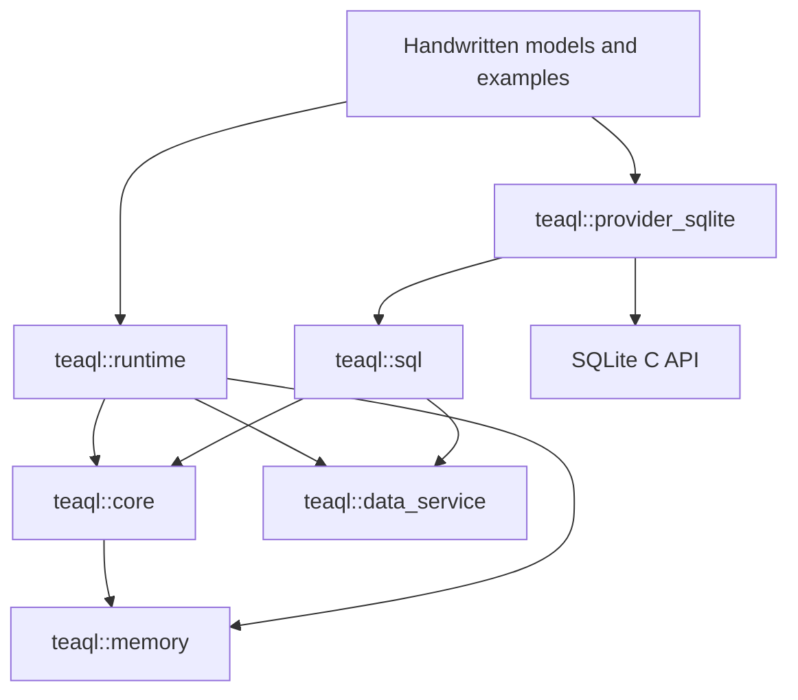

# Rust 5.0.5 core design parity contract

Preserve the pinned Rust version's core concepts, responsibilities, field semantics, execution order, and error behavior. Adapt ownership, allocation, and resource lifetimes for C++. SQLite-only scope does not justify deleting interfaces or merging layers. This contract replaces the initial direction that combined layers and reduced the core model.

Baseline: `62940ae2b88e7acc32763853b8b4685a01c7e90a` in `upstream.lock.json`. The [source concept inventory](parity/upstream-concepts.md) and `parity/upstream-inventory.json` index declarations, committed source hashes, and test locations. They identify omissions; they do not prove structural or behavioral completion. The [module map](parity/cpp-module-map.md), generated from manually maintained `parity/cpp-modules.json`, records targets, stages, differences, and acceptance contracts. Its verifier assigns each of the 82 pinned source files to exactly one contract.

## 1. Concept boundaries

| Rust layer / concepts | C++ responsibility | Current status and required work |
| --- | --- | --- |
| Value / DataType / Decimal / Timestamp | Lossless values, objects/lists, typed NULL, conversions/serialization | All 13 Value variants, conversions, JSON projection, transparent Timestamp integer JSON, and ID text have observations. Decimal arithmetic/ordering/precision/encoding and provider codecs have separate evidence; remaining Decimal reexports need acceptance. |
| PropertyDescriptor / RelationDescriptor / EntityDescriptor | Constraints, relation keys/cardinality/attach/delete_missing, service and audit metadata | Fields, domain copies, optional lookup, and writable_properties exist; SQL consumers use separate required lookup. |
| Expr / BinaryOp / ExprFunction | Full expression trees, functions/subqueries/logic/list values | Variants/builders exist; NOT IN subqueries preserve non-null projection. Generic expression/SELECT/schema compilation has a separate dialect and source comparisons. |
| SafeExpression / TeaqlEmpty | Root-owned optional evaluation, apply/short-circuit/lazy fallback/callback/entity/list access | Evaluation/composition/adapters exist. Same-domain borrows share state; explicit cross-domain copies relocate root/callback state. This is not SQL filtering. |
| query::* | NamedExpr, OrderBy, Aggregate, RelationLoad/RelationAggregate, ObjectGroupBy, raw projections, pagination/streaming | Fields/defaults/builders/recursive materialization ceilings/copies exist. The legacy SQLite path rejects unsupported execution. |
| request::* / dynamic_search::* | QuerySelection and builder/runtime conversion, relation selection/filtering, facets/search | Models/conversions/validation/warnings match 491 observations. Trusted bindings produce AST; entity-level relation/filter/aggregate/facet execution remains pending. |
| Record / CompactRow / SmartList | Named records, compact rows, totals/aggregates/summary/facets/loaded state | Entity conversion/mapping/grouping/merging/ID/version and complete result metadata exist; retain is_loaded. |
| TeaqlEntity / Entity / BaseEntity / IdentifiableEntity / VersionedEntity / Audited | Domain contracts, decoding/write values, loaded/dirty boundaries, reason-bearing save gates | Concepts/CRTP hooks/BaseEntityData/Audited/boxed relations exist; handwritten models are tested, save runtime is pending. |
| MutationValues / EntitySnapshot / GeneratedValues | Write intent, persisted state, provider output | Three separate types; shared internal containers do not make them interchangeable. |
| Insert/Update/Delete/Recover/Batch*Command | Exact command shapes, traces, versions, old_values | Separate commands and SQL batch/guard/reread execution exist. Business save entry points remain pending. Insert has no ID predicate, expected_version, or soft_delete field. |
| core::EntityGraph* | Annotated save input and relation edges | Input graphs/copies exist separately from runtime identity graphs; generic graph save is not established. |
| TraceKind / TraceNode | Hierarchical operation/request/relation/entity/provider/SQL/comment/purpose/audit trace | Preserve full propagation; privacy changes only projections. |
| core::BusinessId* | Definitions/requests/scopes/plans/allocations/values/errors and separate Allocator/Profile/Slot | Core interfaces have 1,188 comparisons; runtime strategies/encoding/allocation/services/schema contribution/orchestration exist. Business save integration remains pending. |
| data-service::* | Provider-independent requests/results/capabilities/observers and query/mutation/guard/transaction/schema/ID interfaces | Separate target/models/provenance/asynchronous streams/quiescence/default observers exist; SQL diagnostics/transaction/stream/provider adapters are connected. Full entity runtime remains pending. |
| SqlDialect / CompiledQuery / SqlBindings | Compilation, parameter provenance, schema SQL, dialect extension | Models/errors/SQLite diagnostic rendering are separate. Generic query/mutation/schema and SQLite dialect have observations. Core compilation has no UserContext/connection dependency; legacy entry takes Memory. |
| SqlTransport / StreamingSqlTransport / SqlTransactionTransport / SqlTransaction | SQL I/O, cursors, transaction resources | Keep separate from data-service transaction/executor abstractions. |
| SqlDataServiceExecutor / SqlDataServiceTransaction | Adapt requests through dialect/transport; metadata, rereads, diagnostics | Do not merge into provider or UserContext. |
| SQLite provider | SqliteDialect/MutationExecutor/SchemaProvider, ID/business-ID allocators, registration | The sole database backend implements SQLite-specific responsibilities only. |
| RuntimeModule / registry / UserContext | Metadata/entities/behavior/checkers/decoders/executors/resources | UserContext is more than an arena; explicit allocation is an additional C++ responsibility. |
| EntityDataService / RuntimeDataService / ContextDataService | Entity queries/saves, Context binding, relations and policy | Layers/basic adapters/observation/relation pagination/recursive identity hydration exist; full orchestration is pending. Examples must ultimately execute through them. |
| EntityKey / EntityGraphBuilder / LoadedRelation / RelationHandle / EntityRuntimeState | Identity consistency, relation state, snapshots, changes and ledger | Separate from core save-input graphs; one identity must not create inconsistent duplicated state. |
| EntityStatus / EntityAction | Full transition table and invalid-transition errors | Version signs or incompatible flags cannot substitute for the state model. |
| GraphNode / GraphMutationPlan / GraphMutationBatch / TraceScopeToken | Input normalization, planning/batches/trace scopes | Models and 432 comparisons exist; normalization/planning/saving remain pending. |
| Checker / TypedChecker / CheckResult / ObjectLocation | Validation, field locations, loaded/dirty boundaries, translation | SQL failure does not substitute for business checks. |
| MutationPolicy / Registry / ApprovalProvider / Governance* | Plan review, version-fingerprint approval, governance events | Preserve missing-policy/approval handling; never silently delete gates or invent allow decisions. |
| TransactionScope / GraphTransactionBoundary | Context transaction and graph-save atomic boundaries | Bind executors, clear ledger after commit, retain retry intent on failure. Follow source event timing without assuming an outbox. |
| RawAuditEvent / SafeAuditEvent / sinks | Separate raw events/output projections and field/snapshot semantics | Constructors/governance/sinks/privacy have 1,427 comparisons; formatter/event delivery exist, with another 1,088 source observations. Save call sites remain pending. |
| SqlLogContext / SqlIntentRedactions / logging / formatter | Provenance/reprojection/intent privacy/outcomes/unified formatting | SQL/audit projections/models/formatters/LogManager/Context buffering exist; business call sites remain pending. |
| SchemaProvider / SchemaExecutor / SchemaInvocation / bootstrap | Metadata services, persistent schema, Context-managed invocation | Distinguish similarly named data-service and runtime interfaces. |
| ID/business-ID services | Allocation/scopes/clocks/sequences/encoding/schema | Core/runtime interfaces, AtomicCounter/Snowflake/SQLite, Global fallback, fixed bootstrap, and schema orchestration exist. Business save integration remains pending. |
| EntityReference / round-trip reference | Claims/encoding/trusted principals/document scope/authorization/decoding | Retain security boundaries; a bare ID cannot substitute for a protected reference. |
| telemetry / i18n / pagination / aggregation-cache interfaces | Observation/language/cursor/ID-set/cache abstractions | Telemetry has 1,032 comparisons; pagination/cache stores and build coordination have separate evidence below. Remaining core interfaces require implementation; external exporters/Redis are excluded. |
| core::web / core::xls | Defined data models and conversions | Excluding web servers/spreadsheet engines must not delete core structures. |

Retain auxiliary types/errors/internal diagnostics/test oracles under their module, or provide source-supported C++ equivalents. Type scans do not fully cover external reexports such as Decimal, public functions/constants, trait defaults, or serialization; audit them with their sources.

## 2. Dependencies

The composition root registers concrete SQLite services with runtime. Providers depend on runtime when implementing runtime interfaces; CMake propagates required error-model linkage. The final runtime must not link the SQLite C API. Its current legacy SqliteSession regression path retains that dependency until entity-runtime wiring replaces it.

SqliteSession must not continue combining compilation, provider I/O, runtime policy, and log projection. Public layers obtain allocation-domain facilities from memory rather than including runtime/context.hpp. Data-service interfaces use provider-independent types and return ExecutionMetadata. Namespaces distinguish identically named concepts from different Rust crates.

## 3. Execution order

Queries: domain Request/PurposedQuery → QuerySelection conversion → EntityDataService → request policy/load planning/executor resolution → QueryRequest → SqlDataServiceExecutor → SqlDialect/SqlBindings → SqlTransport → SQLite → CompactRow/ExecutionMetadata → entity decoding/identity graph/relation loading → SmartList. Streams preserve independent cursor/chunk/cancellation boundaries.

Save entry points have different ordering and must not be collapsed:

- `GraphSaverFor::save_graph_dyn`: `plan_graph` → `graph_policy_plan` → `review_mutation_plan` → transaction begin → `execute_graph_plan_internal` → commit; execution failure rolls back. Rejected plans do not begin transactions.
- `save_ledger_dyn`: detect cancelled new roots → `ledger_policy_plan` → review → begin → `execute_ledger_plan_internal` → reread the current root with the **transaction executor** → commit → `root.clear_committed()`. Reread failure must remain rollback-capable; do not reread with an ambient executor after commit.
- `TransactionScope::save_audited` retains flushed ledgers until outer execution commits successfully. Rollback preserves retry intent. Scope queries/mutations use its actual transaction, not a boolean transaction flag.
- Checker/behavior/required-field gates belong at the corresponding prepare/plan/execute points. Ledger required-field checks precede Deletes/Inserts/Updates.
- Mutations in resolved.rs emit events through UserContext: raw sink → safe projection/sink → formatter. Version 5.0.5 does not uniformly defer this until commit, and rollback does not retract events already delivered to external sinks.

These orders come from entity_save.rs, context/transaction.rs, data_service/graph.rs, resolved.rs, and context.rs::send_event_inner. Differential tests must cover policy rejection, reread/sink/commit failures, and ledger retention, not only final rows.

Logs: compiler provenance → statement execution metadata from provider/executor → runtime safe projection → SQL/unified entry → formatter/sink. Execution input, raw events, and output projections remain independent. Observers report failures/cancellations that cannot return ordinary results. Validate composition against each Rust method; diagrams are not acceptance proof.

## 4. C++ adaptations

- Map traits to concepts or separate interfaces while retaining responsibilities, operations, and errors.
- Explicit Global/User scopes own business objects formerly represented by owned values/Box/Arc. Borrows do not extend Context lifetime; retain identity, relations, and snapshots.
- Use PMR, nested allocator propagation, and explicit destination-domain deep copies without hidden default-heap fallback.
- Stop native work, release resources, and destroy objects before reclaiming every arena block.
- Preserve asynchronous/stream/cancellation semantics despite synchronous SQLite operations. Immediate standard-library implementations are acceptable foundations, not proof of full asynchronous parity.
- Result may use explicit error types/exceptions, but classifications and failure behavior remain required.
- Optimize synchronization, caching, layout, and compact storage without changing observable business behavior.

### Query representation

Rust permits builder/field name collisions that C++ cannot express. These are renamings, not removed fields:

| Rust | C++ storage / operation |
| --- | --- |
| filter / having | predicate / having_predicate, with corresponding builders |
| hard_limit / search_with_text | hard_limit_value / search_text, retaining builders |
| comment / raw_sql | comment_text / raw_sql_text; absent differs from empty |
| partition_by / top_n_probe_parent_threshold | partition_field / top_n_probe_parent_threshold_value |
| group_by / order_by / raw_sql_search_criteria | group_by_fields + group_by(); order_by + add_order(); criteria field + add_raw_sql_search_criteria() |
| namespace / Expr::and / Expr::or | namespace_name / all_of / any_of to avoid C++ keywords |

Expr::kind selects active contents: Column uses name; Value literal; Function function_kind/args; Binary op/two args, with IN lists as Value::List; SubQuery op/left args/separate metadata-query storage; Between three args; unary expressions one arg; And/Or args. Equality compares the active variant.

Recursive ScopedBox storage carries an explicit resource and destroys nested objects without owning/extending Context. Global query/Expr copies recursively copy descriptors, strings, expressions, relation queries, and configuration. Cross-domain moves retain the destination allocator; same-domain moves avoid reallocation. Root destruction cleans nested objects before Context reclaims blocks.

prepare_for_list returns a complete copy. The outer query uses its own hard_limit; relation queries/child enhancements recursively use 10,000. It adds no extra ceiling to object groups/expression subqueries and is not stream preparation. Legacy execution explicitly rejects unsupported advanced fields.

### Schema execution

ensure_schema resolves provider → invokes it with private SchemaInvocation → invokes installed BusinessIdSchemaService → awaits generated bootstraps in registration order. Missing providers/failures stop later stages. Registration is passive and does not run DDL. Runtime schema providers differ from data-service metadata providers: `teaql::runtime::SchemaProvider` and `teaql::SchemaProvider` respectively.

Private invocation/orchestration have 384 comparisons. RuntimeModule descriptors/bootstrap callbacks/sinks/initial-root graphs/entities/behavior/four decoder forms are present with explicit target-domain copies; checker/language registration remains pending.

The physical SQLite provider reads Context metadata, starts a native transaction, installs ID-space support, creates/evolves/verifies tables/indexes, and validates FKs. schema_created/field_added/schema_verified occur after their actions and before commit; source ignores returned delivery errors. Failed COMMIT still attempts ROLLBACK. Success clears query caches, then legacy initial/root graphs produce the typed-bootstrap-required error. Moving that rejection before DDL changes observable side effects.

735 public-entry observations use real UserContext.ensure_schema, not copied DDL logic. Coverage includes sqlite_master, types/nullability/length/numeric domains, full indexes, relation directions/service boundaries/FKs, soundex, Unicode names, repeated calls, rollback-visible events, and post-commit legacy rejection. Native tests cover failed commit/cache timing/sink errors and exceptions/connection wait-close/domain copies. Unicode scalar/four final-sigma digests match Rust 1.97.1 / Unicode 17. Full entity runtime, graph save, and schema backfill remain pending.

Rust generated-bootstrap task-local scope becomes a transient GlobalContext marker plus guards around callbacks/child polls/cancellation. Restore after pending/failure/success; never retain authority across suspension or use TLS/singletons. Context close cancels the outer operation before cancelling children inside its scope. Same-Global synchronous nesting inherits mode; separate applications do not. Tests compare real audit identities/events as well as flags and physical effects.

### Audit models and projection

RawAuditEvent retains values/updated fields/old-new snapshots/changes/trace/bootstrap identity/full governance. Eight event kinds/factories stay separate; missing optional differs from Value::Null. SafeAuditEvent is a distinct type with safe fields/trace/governance and no added bootstrap. EntityKey comparison uses its construction-time cached identity; copies retain it and public ID mutation does not recompute it. Explicit allocator constructors replace Rust new/new_static and copy entity names into the chosen domain.

Count Unicode scalars; mask before truncate. Hidden underscore fields still contribute secrets. Preserve nested credentials, overlapping fields, and stable equal-length secret order. Ordinary raw-log projection copies the event and retains only ID/version business values; credentials remain hidden even under confirmed plaintext. Clear trace entity_type/comment and bootstrap actor/reason; retain category/governance as source. Do not merge raw/safe projections.

Separate raw/safe sinks borrow checked domains. The in-memory raw sink invokes registration order and stops at first failure. Copying collections never extends User sink lifetime. 1,427 observations compile original event/privacy sources; null-default-PMR/close tests cover nested copies. Event delivery/LogManager are documented below; governance/business save integration remains pending.

### SQL log models and reprojection

SqlLogEntry preserves independent context/operation/optional comment-purpose-audit reason/trace path/parameterized SQL/parameter slots/debug-pretty SQL/start-end time/duration/result count-kind/summary. Info and SQL payloads remain separate; unified entries/buffers retain time/user/trace. Options default enabled with separate Select/mutation switches. Legacy examples use separate simplified log types.

Projection consumes compiler-owned policies/generated_sql/intent, preserves slots/count facts, and never exposes Unknown or nested credentials through plaintext requests. Render failure clears every parameter value and intent. Already-safe entries cannot be upgraded. Debug entries hold a private safe copy without original bindings and a SHA256 fingerprint; reprojection validates fields. Tampering/missing state triggers source fallback, hiding intent/trace. Safe copies have no projection state, preventing recursive ownership; domain copies preserve this structure.

425 observations cover full Debug text/reprojection. Native tests disable default PMR and inspect Global copies after User close. SHA256 shares the fixed-storage Business ID implementation without dependencies. Duration retains u64 seconds/nanoseconds and checks carry overflow; timestamps still use ExecutionMetadata's system_clock range, whose equivalence to wider Rust SystemTime requires audit. SQLite is the supported rendering dialect. Context buffering/event delivery exist; business call sites remain pending.

### Formatters, factories, and configuration

LogFormatter has SQL, ordinary-audit, and sensitive-audit entries. The default sensitive method delegates to ordinary audit, so third-party formatters need not expose payloads. Ordinary Human/Debug audit output includes field names/entity IDs; sensitive entries output values/full RawAuditEvent Debug including bootstrap/governance/cached identity. Formatting does not perform privacy projection; LogManager projects first.

Human uses UTC milliseconds, rounded microsecond duration, trace/intent, and missing-projection hints. Debug preserves caller trace separately from entry trace. Sensitive output truncates bytes at UTF-8 boundaries; SQL gains a non-executable marker. 927 comparisons normalize only volatile current-time prefixes, while native tests verify UTC shape/time intervals.

The lazy Global factory reads TEAQL_LOG_FORMAT on first use: json/debug selects DebugReaderFormatter, otherwise Human. Later environment changes do not replace it. Separate applications initialize independently; allocation in User/another Global is rejected. LogConfig preserves exact level tokens, Unicode whitespace trim, ASCII case-insensitivity, and SQL substring filtering. Missing/empty environment tokens and empty vectors/vectors containing an empty string remain distinct. Configuration copies explicitly across domains; outputs use caller-selected arenas.

### LogManager output and application state

GlobalContext explicitly owns LogManager. Configuration, ordinary endpoints, and separate SQL/audit sensitive endpoints initialize lazily, including absent sensitive endpoints. Preserve switch/filter/projection/formatting order. Ordinary files append headers/body; sensitive files append projected bodies truncated to 64 KiB. Source ignores file open/write failures. Headers are attempted once, even when directories appear later. stdout/stderr failures become exceptions; failed first header/plaintext-warning initialization remains poisoned.

Read plaintext permission on each call. Direct audit projection and Manager share one warning state within a Global; different applications initialize independently. Missing/credential fields short-circuit before warnings. This explicit application lifetime replaces source process-static ownership.

94 isolated-process comparisons inspect real files/stdout/stderr, normalizing Human time, executable names, and the inaccurate source JSON header hint: source json chooses Debug, which the C++ header explicitly states. Linux uses /proc/self/exe for default filenames; other platforms currently fall back to teaql.log and need native-path adaptation. Context buffering/event delivery exist; governance/business call sites remain pending.

### Context metadata recording and buffering

Metadata containing statements records child statements recursively without another parent entry. Recover/Batch/Schema map to Update. Disabled options return before projection. Extract the final comment/purpose/audit reason, preserve both normalized-trace branches, and prefer result_count including zero. Negative elapsed intervals become zero; differences across the full signed-nanosecond system_clock range avoid subtraction overflow.

Save safe logs/unified buffer before ordinary output, then sensitive output. Records remain readable after stdout failure. sql_logs returns an independent Context snapshot. clear_sql_logs/disable_sql_log do not change UnifiedLogBuffer; disabling options does not clear existing records. User writes into a registered Global buffer explicitly copy into its domain.

315 observations compile original private logging methods with a minimal fields/get_resource wrapper. Registration has separate runtime evidence; the wrapper is not a complete Context. Native tests cover routing, save-before-output-failure, cross-domain retention, and final close diagnostics.

User identity preserves Some/None/empty setters/builders. Construction captures USER, then USERNAME, then main; invalid UTF-8 behaves as missing. The diagnostic form remains user@pid-N.tid-N. Linux uses native TID and other platforms hash C++ thread IDs rather than reproducing Rust private ThreadId numbering. Strings belong to User.

Event delivery preserves governance/bootstrap attachment, raw sink, safe sink, LogManager, and error order. Physical SQLite schema retains audit inside transactions. Full business/transaction call sites, graph saving, and governance approval require later acceptance.

### Telemetry and propagation

Attribute variants are String/Integer/Float/Boolean. RuntimeOperation retains family/name/ordered attributes and two constructor defaults. attribute rejects only the nine exact source keys; the public container is not retroactively filtered. Error classification retains ASCII normalization/substrings and timeout, authorization, validation, conflict, transport, provider priority.

Telemetry/Scope/PropagationContext/Noop/two FailOpen wrappers remain separate. Registration borrows explicit origin domains; lazy default Noop belongs to User. Start/extract failures do not block business work. Failed activation retries business polling outside activation only if it has not already run; existing poll results survive, while business exceptions propagate. Scope business exceptions preserve source mutex-poisoning state; propagation has no such state. Success/failure consumes one delegate, isolates completion exceptions, and destroys adapters immediately. Unfinished scopes can close or be cleaned with Context.

Noncopyable ContextBox can destroy payloads early while arena bytes remain until close. claim prevents two wrappers consuming one payload. Interfaces return fresh boxes in the selected Context; retaining borrowed call inputs requires explicit copies. Destructors are noexcept. Context is owner-thread-bound; reentrant finish/activation is explicitly rejected rather than blocking on a Rust mutex.

1,032 public API observations cover values/filtering/classification/completion order/adapter and business exceptions/skipped or repeated callbacks/poisoning/propagation. Native tests cover Global copies/one cleanup/domain rejection/thread wake/finish/cancel through scope/propagation operation composition. run borrows scope and same-domain child work; all work stops before payload destruction/reclamation. No exporter/pool/static owner is added. Event delivery and Context query adapters are connected; complete entity/mutation call sites remain pending. flush/shutdown retain defaults without invented automatic timing.

### Governance scope and event delivery

with_mutation_governance copies snapshots into operation Users. Each poll/cancel/nested cleanup activates its snapshot, then restores the prior value; suspension retains no active authority. Global holds only a synchronous-stack borrow, replacing task-local storage without TLS. Sibling Users share activation through synchronous calls within one application; separate applications isolate it.

send_event copies input into User and unconditionally replaces supplied governance with the active snapshot, clearing forged snapshots outside a scope. Bootstrap identity overrides only Created/Updated. The last comment remains meaningful even when empty; only absent trace selects the default reason. Present null/invalid new_values versions prevent fallback to values. Other events/non-bootstrap calls retain supplied bootstrap identity.

Call raw sink, safe projection/sink using matching metadata mask/max settings, then LogManager. First Result error stops the chain and completes telemetry as audit_error; success has empty attributes. Sink/log exceptions propagate, close scope immediately, and do not invent completion outcomes. Module sink installation copies domain-checked borrows; User sinks cannot escape to Global/siblings.

1,088 observations extract original event/task-local method bodies; the wrapper supplies fields/services while actual event/privacy/formatter/telemetry code runs. Oracle-only tokio is already locked and is not a C++ dependency. Cover all eight events, identity overrides, empty reasons, missing/null/invalid versions, governance, sink errors/exceptions, masks, and scope release. Normalize only timestamps inside the send interval. Native tests cover nesting/pending/close/domain rejection/Global copies and real sink→file-log→telemetry order. Policy/approval/graph/business save remain pending.

### Identity graphs and mutation ledgers

Builder installs by C++ type/u64 ID; relation views use normalized owner name/ID/relation and replace same-key payloads. Frozen publication returns Context borrows and is single-use; failure returns the original builder. References retain ordinary/weak graph views and clone promotion without Arc/Weak lifetime extension.

Loaded/Empty/NotLoaded remain distinct: empty collections have values, empty to-one does not. Strict mismatched handles fail; optional resolvers return empty. Inspecting these states performs no database read.

Same-domain runtime copies share the lazy ledger slot, including copies before first mutation. Loaded CompactRow is per-view snapshot and does not allocate a ledger. Reads prefer loaded data; original versions consult ledger, then entity/numeric-ID loaded fallback. Change stacks preserve top overlays/pop/cross-layer fields/delete-clears-all. clear_committed consumes intent but retains loaded rows and deferred composition errors.

Composition checks target/source states and every source original version before copying changes, so conflicts are atomic. Successful layers merge into the target current layer; sources remain independent/retryable. Void attachment records deferred conflicts. Existing target comments, including empty strings, and original snapshots win. Preserve first-version storage separately from ordered overflow to retain first-conflict order.

241 observations compile complete entity_runtime.rs with thin private-state bridges, not rewritten algorithms. Native tests cover defaults/Context close/cyclic and aliased copies/PMR/move-only payloads/copy-scope recovery on exception. Owner-thread rules do not prove cross-thread Arc/Mutex parity or ledger-save integration.

### Runtime graphs, plans, and trace

EntityValues is mutable checker/fix/planner state, separate from mutation values/snapshots/compact rows, with destination-domain conversion. GraphNode preserves operation/relations/optional comment/dirty/original fields and cannot be replaced by the core input node. Keep four graph operations/four mutation kinds; graph_mutation_kind_for_update adapts the source enum helper.

Plans retain root/items/batches/index/visited identities. push uses then increments index; Debug checks overflow, Release preserves unsigned wrap. Rebuild merges only adjacent equal entity/kind/field-list items; only Update fields affect keys, and original order/duplicates remain. grouped_counts reads batches even before rebuild. Clearing items does not reset index/batches. Context-owned unordered_set retains identity membership, not Rust randomized iteration.

TraceScopeToken is a persistent arena parent chain. Same-domain plans/items/batches borrow it; cross-domain copies recursively copy required parents. ScopedCommentNode is a separate stack cons-list owning its node and borrowing its parent. Both skip only empty comments, preserve whitespace/kind/entity/ID, and output root-to-leaf. Parent links are immutable and acyclic.

432 public observations cover defaults/optionals/nesting/value conversion/field filtering/adjacent batches/counts/rebuild/clear/trace restoration. Native tests disable default PMR and cover nested copies/source close/same-domain tokens/invalid parent domains. Initial/root registration retains full models with destination-copy replacement. Physical SQLite schema is connected; normalization/planning/checking/graph and ledger saving remain pending.

## 5. Stage acceptance gates

1. **Design:** pinned inventory, complete concept map, dependencies/flows, memory rules, differences, and acceptance table.
2. **Models:** complete fields/enums/defaults/conversions/serialization/AST/collections/entity contracts; passing cross-domain/nested/exception/destruction tests.
3. **Layers:** separate interface tests and replaceable executor/transport fixtures; SQLite schema/query/mutation/guard/transaction/stream/ID; atomic guard+mutation statement, complete metadata, and reread evidence.
4. **Query runtime:** EntityDataService performs relations/identity reuse/projection-load boundaries/order/aggregate/pagination/dynamic search. Examples must not implement those responsibilities locally.
5. **Save/log runtime:** status transitions, ledger composition, planning/batches/checking/policy/approval/rollback/rereads/raw-safe audit/privacy/failure diagnostics have differential evidence.
6. **Parity:** identical Rust/C++ fixtures compare results/identity/state/transactions/audit/log success and failure. Examples/lifetime stress/ASan/UBSan pass and no required difference remains unexplained. Performance is not correctness proof.

Names, placeholders, capability flags, complete inventories, successful examples, and isolated green tests do not establish a stage. Deliverables must point to real implementations and evidence covering the required semantics.

## 6. Scope and dependencies

Do not implement MySQL/PostgreSQL/cloud/Redis/web frameworks/external exporters/GPU SDKs in this migration. Preserve their relevant core interfaces/models. Use handwritten models with unchanged entity semantics; do not modify the generator. memory.rs is a test oracle; telemetry_opentelemetry.rs is an optional external adapter. Index both without reducing core telemetry.

The standard library does not directly replace Decimal/JSON/cryptographic libraries. Provide concrete tested implementations, not unsafe/lossy approximations. Justify purpose/necessity/cost before adding dependencies.

Serialization follows actual source implementations. Rust Value/DataType/Expr/SelectQuery/SmartList have no Serialize/Deserialize protocol; do not invent tagged Value serde. JSON projection, transparent integer Timestamp, trimmed strings, and Web/Xls fields/defaults/JSON have corresponding implementations and observations.

### Graph decoding and behavior registration

Four independent decoder maps remain: compact/batch/list/option. Compact/batch validate u64 identity after model decode; batch installs each success immediately and preserves it on later failure. List skips u64 validation and installs a loaded SmartList only after all rows succeed. Option decodes only the first row; empty input installs None. Failed relation decodes do not replace old relations. Every call creates a fresh weak root, shared within its batch/list and isolated from the external ledger; published views resolve the same graph.

Behavior/registry/RequestPolicy are separate, with five default hooks and empty relation_loads. Module metadata uses descriptor.name; decoders use ENTITY_NAME. Behavior-only registration does not create a service; descriptor replacement does not erase decoders/behavior. apply_to copies registries into destination and preserves existing request policy.

Global/User owns behavior/policy while registration borrows. Verify all copies before installation, preserving atomic failure. Clear policy only removes a borrow. Root/builder must share a Context; copy explicitly before cross-domain calls. Empty lookups do not allocate and remain readable in quiescence. 182 public observations plus native graph/domain/resource/SQLite tests cover these contracts; full check/save integration remains pending.

Query preparation first merges repository trace, then dispatches behavior by query.entity, invokes before_select, invokes policy, and adds relation local-key projection. Generated bootstrap skips behavior only, not policy. Public behavior lookup itself does not apply this bypass. Preserve all four service/metadata roles separately from SQL/provider.

### Basic entity services and relation plans

Context resolves entity registration, metadata, then the requested executor type. for_executor can bind another executor for transaction adaptation. Factories create distinct select/insert/update/delete/recover commands. Update behavior uses repository entity; query behavior uses query.entity. Both copy caller input before preparation.

Base fetch_all forwards executor diagnostics; list/entities record returned metadata before decode; enhanced entities aliases ordinary decode and does no hydration. Base trace/comment still propagate when capture is disabled; full entity entry points must restore their own switches. Context preserves trace precedence/user prefix/empty comment rules.

RelationLoadPlan keeps fields/full optional query/children. Behavior dotted paths sort/merge heads; explicit loads retain order/duplicates. Queries use actual target/local-foreign keys, add keys to nonempty projections/child plans, set slice partitioning, and append actual-ID ordering. Compact clears nested relations. Empty parent-ID construction adds no IN; execution/hydration must skip that query.

Nonnegative I64/U64 share numeric identity; text numbers do not. Equal-key unstable-sort representation is unspecified; C++ retains the first equivalent value. Flat plans preserve explicit and behavior queries independently; every descendant requires a decoder, and planning errors precede eligibility checks.

Private intent belongs to the query scope. Descendants copy snapshots; siblings do not mutate each other. Multi-statement metadata propagates normalized per-leaf policies without replacing caller metadata before safe projection. Do not attach private intent to UserContext/shared repositories/wire requests/ledgers.

256 base-method and 112 planning observations cover entries/capture/debug/execution-decode errors/observers/trace. Native tests cover hooks/policy/bootstrap/cancel/wake/temporary wrapper destruction/domains/copies/real layered SQLite. Full entity fetch/pagination/cache/insert checking/save remain pending.

### Context query observation and per-parent relation pagination

Noop creates neither operation names nor scopes. Enabled observation creates query scope, then provider scope within its activation. Each poll activates both in order, restores after return, completes provider before query, and classifies returned errors as data_service_error without sensitive attributes. Cancellation closes scopes without fabricated completion. Fail-open isolates telemetry start/activation/completion exceptions.

fetch_all resolves trace/user/comment lazily on first poll; list/entities/enhanced preserve input comments. Keep this source difference. Query snapshots and child work can outlive temporary service wrappers but results remain User borrows. 468 verbatim-method comparisons cover fields/scopes/pending/cancel/errors/Noop/repeated-skipped callbacks/adapters. Normalize only language-specific provider.kind/type-derived operation names. Native tests verify wake and stop before scope destruction.

Top-N plans retain Window/BoundedProbes. Only many relations with slices permit probes. Explicit zero disables; positive thresholds compare unique parent count; absent thresholds follow capabilities. No IDs means no capabilities/query calls. Probe-capable providers with no explicit threshold and disabled metadata receive one partitioned semantic batch query; other probes issue sequential per-parent equality queries with partition cleared. First error stops; cancellation stops active child.

Compact window/batch clears relations, but explicit probes retain source base-query relations. Preserve slice/projections/stable ID and limited relation-load attributes. Compose through entity-fetch callbacks rather than bypassing runtime to provider. 432 observations plus SQLite pagination/tie/metadata/domain-copy tests cover execution; complete public fetch/identity publication remains separate.

### Recursive hydration and graph installation

Embedded hydration attaches first, then recursively processes each record/child. Ordinary/compact identity hydration completes descendants before installing the current level through the decoder registry. Ordinary strips partition rank and marks missing forward-one with Null; compact keeps rank and installs all returned targets. Only nonnegative signed/unsigned integers share identity.

Embedded groups are rereadable; ordinary/compact reverse installs consume groups, so duplicate parent keys can later receive loaded-empty relations. Inverse uses the first metadata match by key/direction. Embedded parents remove the current relation before inverse embedding; inverse-many appends only to List and preserves other types. Ordinary flat installs inverse before checking literal parent id, preserving partial updates on error. Compact has no inverse install. Keep empty/unloaded states, decoder forms, and fresh ledgers distinct.

First error/cancellation preserves partial updates. mem::take leaves the active embedded record empty on failure/cancel; earlier successful records survive. Child repositories retain trace/private-intent domain rules. Only embedded loading adds its relation-load telemetry. 356 original-method comparisons and SQLite/thread tests cover rows/graph/ledger/query order/trace/scopes/snapshot/cancel/close. Global graph copies preserve cycles/aliases.

Full compact/public entity fetch and purpose/cache/pagination orchestration remain pending. Examples must use the runtime. Save/check/governance require their own acceptance.

### Aggregates, object groups, and child enhancement

Three kernels compose independently through entity-fetch callbacks. Parent keys preserve duplicates/input order. Relation aggregates validate complete plans, including relations later cleared, before empty-ID defaults. Queries select actual targets, clear ordinary/expression projection/order/slice/relations, retain raw/other fields, and add count if absent. Single counts use outer alias; list counts use count. Child TTL propagates only without explicit child cache settings and with parent propagate; parent enabled does not affect propagation. This is configuration behavior, not cache execution proof.

Re-fetch metadata after rows return; physical foreign columns map to logical keys only if the logical key is missing. Remove foreign keys during grouping. Single takes first row and unwraps exactly one column; zero/multiple columns remain objects. Lists retain every object. Missing groups/parent keys produce U64(0)/empty List, including keyless parents. Duplicate parents reuse groups rather than consuming them.

Object groups/child queries preserve original queries and add needed ID projection/IN. Last duplicate target wins. Groups set Null only for keyed unmatched parents; keyless parents remain unchanged. Child enhancement merges hits only, preserving unreturned fields/unmatched rows. Both use parent trace; aggregate appends target/alias trace while preserving query trace.

Execute sequentially; preserve completed enhancements on failure/cancel and do not modify the active pending step early. 266 original-method observations compare rows/full relevant query fields/trace/errors/pending/cancel, including physical/logical coexistence, mixed identities, and planning-before-empty order. SQLite count/sum/object/overwrite and native stop/all-block tests cover kernels. Public entries must compose them in full resolved.rs order.

### Cache and pagination storage boundaries

AggregationCacheBackend, ContinuousPageCursorStore, and IdSetStore are separate. Aggregation access is synchronous: age zero is unlimited, other age uses monotonic time, and expired reads retain entries. Namespace invalidation matches namespace::. name_space adapts a C++ keyword only.

Cursor fields retain identity/query/entity/direction/boundary/page size/offset/deadline. Keys are query_key:offset. get deletes the expired target; full-capacity put evicts one earliest deadline without proactively purging others. Invalidation matches query_key:. Default capacity is 4,096. ID sets retain ordered duplicates/deadline; oversized single writes fail before expiry purge, then count/byte checks repeatedly evict earliest. Replacement undergoes the same checks. Invalidation matches full keys; defaults are 64 entries/256 MiB ID elements. Equal-deadline HashMap survivors remain unspecified.

SystemTime uses signed 64-bit seconds plus nanoseconds for pinned Unix Rust range, rather than narrowing to a roughly ±292-year nanosecond time_point. Deadlines use wall time, separate from business-date clocks/cache monotonic age. Default stores belong to User; Global stores require explicit origin registration. Observations start DISABLED/ID_SET_DISABLED and independently update cursor/count, returning domain copies.

Memory stores return lazy operations; unpolled canceled writes have no effect. Replaceable interfaces permit native async work. Reads copy to result domains and writes to store domains; retained IDs have no Arc owner. Owner-thread access does not prove Send/Sync/poisoning equivalence. Background work only notifies owner and stops before close.

259 comparisons compile original storage/observation code with private capacity/age bridges. Native tests cover domains/default isolation/replacement/outstanding work/finish-cancel-close/full deadlines. Same-key Registry/Lock/Guard primitives reuse application mutex identity and prune zero-lease entries on the next lookup. Unlock wakes one waiter; cancellation of a notified waiter transfers wake. Slots mirror source reuse without FIFO fairness; new pollers may overtake. 144 scripts compare the original registry/actual locked mutex's identity/readiness/wakes/guard/cancel. Native tests disable default PMR and join work before unlocking/reclamation.

Explicit Global ownership replaces process-static Weak/Arc directories. Separate applications isolate directories. User leases/guards/waits do not own directory memory or escape to longer domains. Reset requires prior cancellation/guard release; Context close handles dependency-order cleanup. These primitives still need miss→lock→recheck→build integration. Canonical key helpers now have separate evidence below. Cache hits/write invalidation and continuous/ID-set query strategies remain pending; stores/locks alone are not complete entity-query acceptance.

## Canonical aggregation and pagination query keys

The pinned aggregation key copies and recursively canonicalizes filter/having,
expression projections, expression order, relation child queries, object groups,
child enhancements, and subqueries. AND/OR flatten only the same operator, sort
stably by Rust Debug, and deduplicate adjacent structurally equal expressions.
IN/NOT IN and their large-set forms sort/deduplicate literal lists by Value Debug.
NaN remains unequal to itself; equal signed zeros keep the first sorted
representation. Empty and singleton AND/OR retain their variant. Canonical queries
remove aggregation cache, comments, trace, stream configuration, and continuous-page
configuration, while retaining result-affecting fields and ID-set configuration.

Continuous-page keys remove comment/trace and zero only slice offset. ID-set keys
remove the whole slice, projection/expression projection, relations, child
and object enhancements, comments/trace, and both pagination options. They retain
other fields, including stream and aggregation-cache options. Neither path sorts
predicates. Both hash namespace, exact normalized query Debug, and optional user
identity; ID-set additionally hashes active root entity and ID when supplied.

451 observations compile the original helper/key methods without rewriting the
algorithms. They compare complete Debug/canonical text and all three keys, covering
nested metadata/query fields, every expression/function/aggregate, Value kinds,
duplicates, NaN, signed zero, Unicode/NUL, hash block boundaries, None/empty identity,
and root variants. Pagination hashing matches DefaultHasher's SipHash-1-3 and Hash
framing on the pinned 64-bit little-endian Rust test toolchain; this is a local
compatibility key, not a portable serialized protocol or cryptographic API.

Inputs are unchanged. Temporary queries, sort keys/indexes, and outputs allocate
in explicit destination Memory; native tests disable default PMR and read retained
Global queries/keys after User close. Internal Debug contains query values and is
not a public log projection. The helpers do not yet integrate entity-level
cache hit/miss/invalidation, active Context roots, or complete pagination execution.
